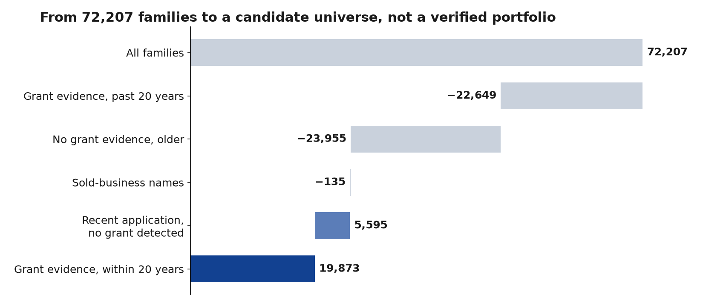
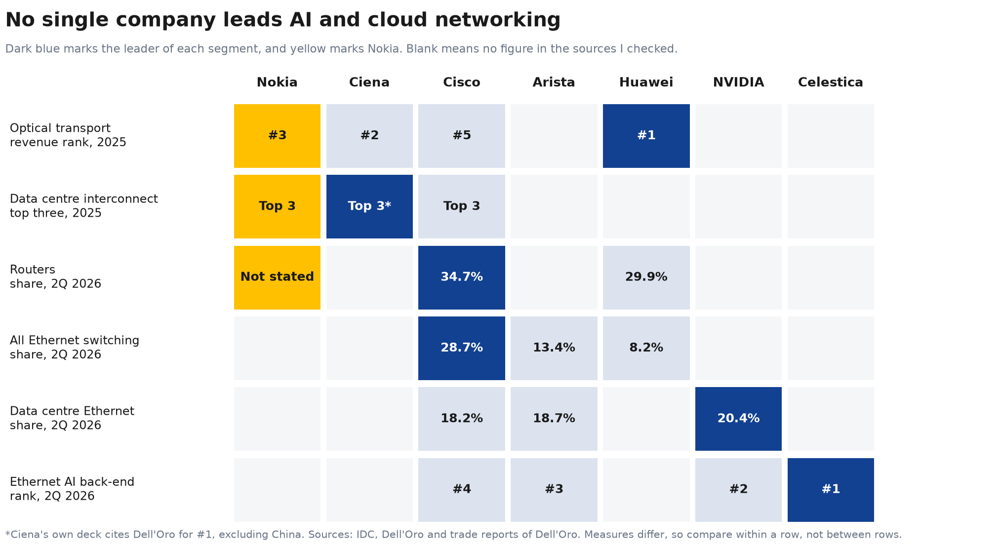

# Nokia Patent Portfolio Investment Analysis

**Independent research project | [Financial Data Engineering / Business Data Analytics Trainee](https://www.linkedin.com/jobs/view/4483030441) application, Business Data Analytics track**

Not affiliated with Nokia.

## Research question

**How should Nokia prioritise its patent portfolio investments to support its AI and cloud infrastructure strategy?**

## Research scope

This project investigates Nokia's publicly observable patent portfolio and its position in three technology areas relevant to AI and cloud infrastructure:

- Optical networking
- IP routing
- Data-centre switching

Nokia is benchmarked against Ciena, Cisco and Arista Networks, with Huawei as an additional global reference. [Full scope](docs/01-research-design/scope.md).

## Research objective

To examine Nokia's technology position, competitor activity, commercial developments and patent portfolio characteristics, and identify where investment could be maintained, expanded, reallocated or investigated further.

## Methodology

The research combines patent-family analysis, claim-based technology classification, competitor benchmarking, public financial and commercial information, geographic protection analysis and ten-year patent maintenance cost modelling.

Classification rules, assumptions and data transformations are documented so that the work can be rerun and checked. [Research design](docs/01-research-design/research-design.md).

## Data limitations

The research relies only on publicly available information. It doesn't include Nokia's internal patent spending, portfolio valuations, confidential licensing arrangements or internal R&D investment decisions.

So calculated indicators and recommendations are independent external assessments based on observable evidence. They aren't definitive assessments of Nokia's internal portfolio strategy.

## Research status

**There's no answer to the central question yet.** [Full tracker](docs/appendices/evidence-gaps.md).

| Workstream | Status | Where it stands |
|---|---|---|
| Research design and scope | Defined | [Five research questions](docs/01-research-design/research-questions.md) |
| Candidate portfolio universe | Preliminary | [Counts are not verified rights or owners](docs/02-methodology/candidate-portfolio-universe.md) |
| Technology classification | Under validation | [Code pools failed my 85% precision bar](docs/02-methodology/validation.md#precision-result) on preliminary first-pass labels. Human hand-labelling, human–software agreement and recall not done |
| Competitor selection | Defined | [Peer selection](docs/03-market-and-patent-analysis/market-context-and-peer-selection.md) |
| Competitive patent analysis | First estimates | [Low confidence](docs/03-market-and-patent-analysis/patent-landscape.md) |
| Commercial and patent alignment | Pending | [Inputs collected](docs/03-market-and-patent-analysis/commercial-alignment.md) |
| Ten-year maintenance cost model | Designed, not built | [Q9 design](docs/04-financial-analysis/ten-year-maintenance-cost-model.md). US fees and a [break-even](docs/04-financial-analysis/us-renewal-break-even.md) done |
| Investment recommendations | Pending | [Provisional findings only](docs/05-findings-and-recommendations/findings.md) |

## Main results so far

### Patent codes alone can't compare companies

Preliminary software-assisted claim checks compared each code pool with what the patent claims actually say, with company, pool and codes hidden. These first-pass labels haven't been human reviewed.

| Code pool | Claims match, of 100 sampled | 95% range | 85% bar |
|---|---:|---|---|
| Optical | 73 | 64–81% | Fail |
| IP routing | 39 | 30–49% | Fail |
| Data-centre switching (H04L 49) | 42 | 33–52% | Fail |

### Nokia-lineage patents show far more transfers than competitors' patents

42 of 179 sampled Nokia-lineage patents (23.5%) show another current assignee on Google Patents, such as WSOU or RPX, against 2 of 242 for the other four companies. Google Patents isn't a register, so [this needs checking against USPTO records](docs/02-methodology/candidate-portfolio-universe.md#current-owner-evidence-so-far).

### The candidate universe isn't a verified portfolio



19,873 families have grant evidence and were filed within 20 years, and 5,595 more have a recent application with no grant detected. Absence of a detected grant isn't proof of pending status. Verified active rights and verified current owners are both still at 0.

### First estimates: strongest in optical, thinnest in switching

| Estimated US families (95% range) | Optical | IP routing | Switching |
|---|---|---|---|
| **Nokia lineage** | 768 (641–840) | 233 (151–329) | 70 (46–97) |
| Ciena | 263 (169–342) | 90 (47–146) | 40 (24–57) |
| Cisco, with Acacia and Luxtera | 233 (155–294) | 792 (410–1,284) | 220 (120–337) |
| Arista | 9 (5–12) | 143 (74–198) | 33 (14–57) |
| Huawei | 746 (423–950) | 714 (300–1,226) | 175 (73–300) |

Low confidence: small samples, recall untested, and not yet adjusted for transfers. [The adjusted version](docs/03-market-and-patent-analysis/patent-landscape.md#the-same-estimate-keeping-only-patents-without-another-current-assignee) lowers Nokia's switching estimate to 26.

### No single company leads AI and cloud networking



Market share isn't patent strength. [Sources and peer selection](docs/03-market-and-patent-analysis/market-context-and-peer-selection.md).

## Guide to the repo

| Folder | Contents |
|---|---|
| [1. Research design](docs/01-research-design/research-design.md) | The protocol, [scope](docs/01-research-design/scope.md) and [research questions](docs/01-research-design/research-questions.md) |
| 2. Methodology | [Codebook](docs/02-methodology/classification-codebook.md), [validation](docs/02-methodology/validation.md), [candidate universe](docs/02-methodology/candidate-portfolio-universe.md), [data quality and lineage](docs/02-methodology/data-quality-and-lineage.md), [metrics](docs/02-methodology/metrics.md) |
| 3. Market and patent analysis | [Peer selection](docs/03-market-and-patent-analysis/market-context-and-peer-selection.md), [patent landscape](docs/03-market-and-patent-analysis/patent-landscape.md), [commercial alignment](docs/03-market-and-patent-analysis/commercial-alignment.md), [twenty years of reported figures](docs/03-market-and-patent-analysis/twenty-years.md) |
| 4. Financial analysis | [Ten-year cost model](docs/04-financial-analysis/ten-year-maintenance-cost-model.md), [assumptions and scenarios](docs/04-financial-analysis/assumptions-and-scenarios.md), [US break-even](docs/04-financial-analysis/us-renewal-break-even.md) |
| 5. Findings | [Findings so far](docs/05-findings-and-recommendations/findings.md) |
| Appendices | [Progress tracker](docs/appendices/evidence-gaps.md), [fact checks](docs/appendices/sources.md), [data map](docs/appendices/data-map.md), [working principles](docs/appendices/working-principles.md) |
| How I learned | [Learning log](docs/appendices/learning-log.md), [research log](docs/appendices/research-log.md), [question notebook](docs/appendices/questions.md), [knowledge check](docs/appendices/explain-it.md) |
| Code and data | [`sql/`](sql/README.md), [`src/`](src), [`tests/`](tests), [`data/`](docs/appendices/data-map.md#repository-data-folders), [`config/`](config/research_parameters.toml) |

## Run it yourself

```bash
python3 src/run_all.py
```

That reruns the cleaning, scoring, checks and tests, using only the standard library and Python 3.11 or later. To redraw the charts as well:

```bash
pip install -r requirements.txt
python3 src/run_all.py --charts
```

To get Nokia's annual reports, set your own contact, as the SEC requires one:

```bash
SEC_USER_AGENT="Your Name you@example.com" python3 src/download_annual_reports.py
```

The reports stay out of the repo because of their size, and [the manifest](data/raw/annual_reports_manifest.csv) records each file's source and fingerprint. BigQuery steps are listed in [`sql/README.md`](sql/README.md) and consolidated cell by cell in [`notebooks/patent_portfolio_queries.ipynb`](notebooks/patent_portfolio_queries.ipynb); they rebuild the sandbox tables, which expire after 60 days.

## How this was made

I chose the question, sources and method, and I am responsible for the methods, validation, calculations and conclusions. I used Claude for script drafting, browser-assisted query execution, document drafting and software-generated first-pass patent labels, and ChatGPT for a repository-structure review. Those labels haven't been human reviewed; the [validation page](docs/02-methodology/validation.md#who-labelled-what) records what remains to be checked.
