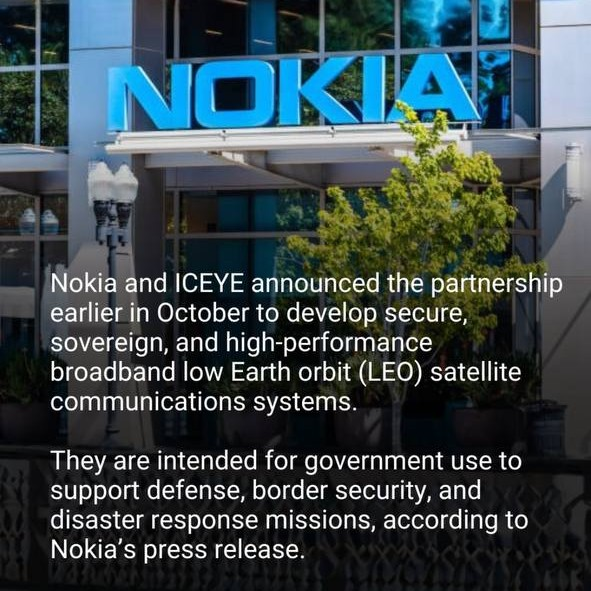
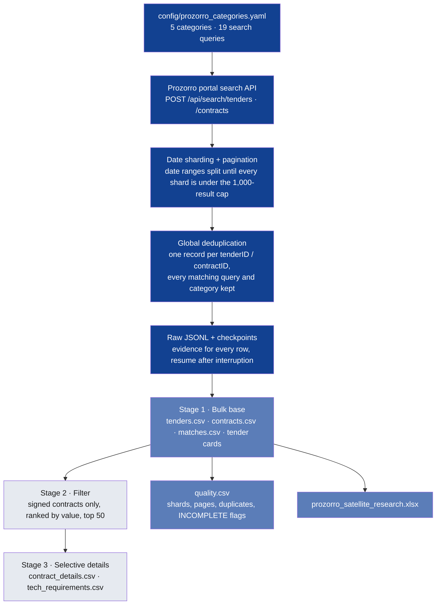

# Nokia–ICEYE Sovereign LEO Communications

**Exploring the technology, patent landscape, and strategic considerations behind a sovereign satellite communications capability for Ukraine.**

*The project was widely described as Ukraine's "Starlink alternative" after a foreign provider restricted Ukraine's satellite service without warning for ten days. The disruption highlighted the risks of relying on an external network. Nokia and ICEYE describe their proposed system as a complement to existing military, commercial, and government networks, not a replacement. [Background and sources](docs/01-research-design/pivot-sovereign-satcom.md).*


**Independent research project | Developed in connection with the [Financial Data Engineering / Business Data Analytics Trainee](https://www.linkedin.com/jobs/view/4483030441) application, Business Data Analytics track.**

*Not affiliated with or endorsed by Nokia or ICEYE.*

## Why this repo exists

I came across Nokia's Financial Data Engineering / Business Data Analytics Trainee vacancy and started this repository as a way to develop the analytical skills the role calls for.

Patent portfolio analysis was new to me, so I approached this as a practical learning project: starting with a real question, working with public data, and building the pipeline needed to analyse it. I document the methodology, assumptions and limitations along the way, aiming to produce a useful work sample while learning the process behind the results.

The research questions changed as I worked through the data and figured out what was worth investigating. Since I am not a subject-matter expert on satcom, I learned about the terminology and industry as I worked with each dataset.

Then, in October 2026, Nokia and ICEYE announced a partnership on sovereign LEO satellite communications. On 22 October, they also signed a Letter of Intent with Ukraine's Ministry of Defence.

<p>
  
  
  
</p>

I came across the announcement while working on the project. The timing was unexpected, and it gave the research a new dimension.

## What the project is about now

A sovereign satellite communications system needs five kinds of technology: the satellites themselves, ground stations, user terminals, the network software that ties space and ground together, and security (encryption, anti-jamming). Building one creates three business problems:

1. Do Nokia and ICEYE already hold the technology they need, or must they buy or license it from someone?
2. Could competitors' patents get in the way?
3. What should their engineers and IP lawyers check before serious money is committed?

This project examines the patent portfolios of Nokia, ICEYE and selected competitors to understand their positions in satellite communications technologies. The repository contains the SQL and Python tools used to collect, clean, group and analyse patent data, map technology areas, validate classifications against patent claims, and bring together the market and financial context needed to interpret the findings.

The formal research question (kept word-for-word identical across the repo by an automated test):

> **What can Nokia and ICEYE realistically reuse from their existing technology assets to deliver a sovereign satellite communications system, and what must they develop, acquire or obtain from other partners?**

Updated 24 November 2026. The project now focuses on three research questions that can be investigated using public data. See the [research questions](docs/01-research-design/research-questions.md) and [plain-language glossary](docs/glossary.md).

## What I actually do here

1. Pull patent records from Google's public patent dataset (BigQuery).
2. Clean up company names, so "Nokia", "Alcatel-Lucent" and "Infinera" count as one lineage.
3. Count each invention once (a patent family), even if it was filed in twenty countries.
4. Sort patents into the five technology buckets above — and **check the sorting by actually reading the patents**. Current status: the sorting failed its own accuracy test on 13 November (70.8% correct against an 85% requirement). Until it passes, no company comparisons are published. Fixing the sorting rules is the next real task.
5. Only after the buckets pass: compare Nokia, ICEYE and competitors, and write up what that means for the three business problems.

Separately, the repository now also tracks the demand side: what Ukrainian and European government buyers actually purchase in satellite communications, through public procurement records ([Prozorro pipeline](docs/01-research-design/procurement-demand.md)). Patents show who owns technology; procurement shows who buys it, at what price, and where the current supply fails.



Everything is scripted and can be rerun: [`sql/`](sql/README.md) for the queries, [`src/`](src) for the pipeline, [`tests/`](tests) for the consistency checks.

## What we know so far

Four findings stand, each with its query and data on file:

- **Ukraine has no domestic satellite-communications patent base.** Sixteen individual inventors with one family each; no companies. Only 16 satcom patent families were ever filed at the Ukrainian patent office, by 10 foreign owners. So the system's technology will be foreign-patented, and the terms of access (license, partnership, purchase) become the real sovereignty question. This says nothing about Ukrainian engineering ability — patents don't measure that, and classified defence work never patents. ([queries 25–28](sql/README.md))
- **ICEYE's patent record is radar and satellite platforms, not communications.** 53 patent families: 35 radar imaging, 14 spacecraft operations, only 7 in transmission. My working guess, labelled as a guess: the communications technology in the partnership comes from Nokia. The actual split is not public, and few patents does not mean little capability. ([queries 24, 35, 36](sql/README.md))
- **The incumbents hold deep patent positions.** Airbus ~19,500 families, Thales ~9,900, Viasat ~800 in our cleaned data. Anyone building in this space builds next to those positions — that's where dependency risk would come from.
- **Patent data can't see the market leader.** SpaceX holds only 110 families — it keeps technology as trade secrets. So no patent-based comparison with Starlink is possible, and I say so wherever comparisons appear. ([query 30](sql/30_spacex_name_counts.sql))

## Honest status

| Part | State |
|---|---|
| Data pipeline (extraction, cleaning, deduplication) | Works, reproducible |
| Ukraine domestic-base analysis | Done (above) |
| Prozorro procurement pipeline | 1,867 Starlink tenders and 4,050 plans extracted; full multi-category run in progress |
| Technology sorting into five buckets | **Failed its own accuracy test** — being redesigned |
| Company comparisons | On hold until the sorting passes |
| Old optical-networking analysis | [Archived](archive/pre-pivot/) — different question, kept as proof of method |
| Ten-year patent cost model | [Parked](archive/parked-financial-analysis/) — answered a question nobody is asking right now |

Full detail: [research design](docs/01-research-design/research-design.md) · [research questions](docs/01-research-design/research-questions.md) · [findings with evidence](docs/05-findings-and-recommendations/findings.md) · [progress tracker](docs/appendices/evidence-gaps.md) · [glossary in plain language](docs/glossary.md)

## Run it yourself

```bash
python3 src/run_all.py
```

Reruns the cleaning, scoring, checks and tests with only the standard library (Python 3.11+). On a fresh clone, the two steps that need my local patent-claim pages (gitignored, since they mirror claim text) skip themselves cleanly and keep the committed results. Add `--charts` (needs `pip install -r requirements.txt`) to redraw the charts. BigQuery steps are listed in [`sql/README.md`](sql/README.md).

## How this was made

I chose the question, sources and method, and I am responsible for the methods, validation, calculations and conclusions. I used Claude for script drafting, query execution, document drafting and first-pass patent labels, and Kimi / Kimi Code for repository-structure reviews and the 24 November restructure. The [validation page](docs/02-methodology/validation.md#who-labelled-what) records exactly what a human still has to check.
