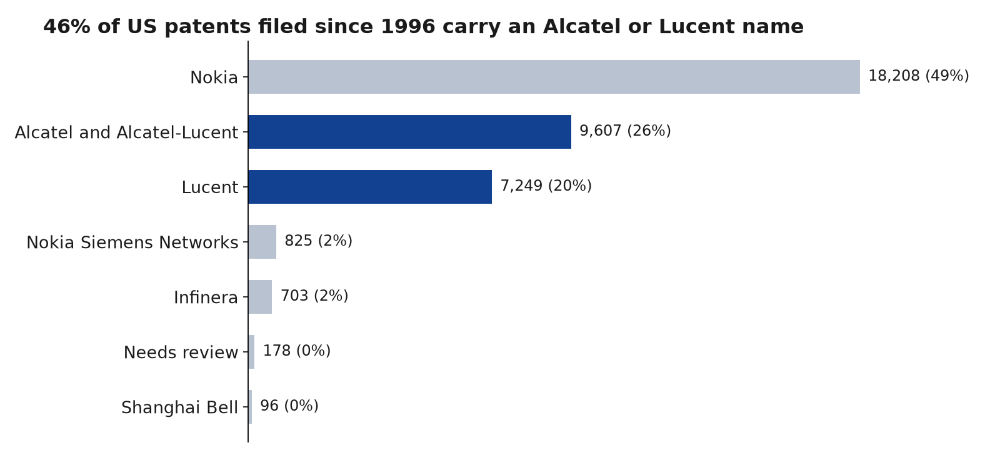
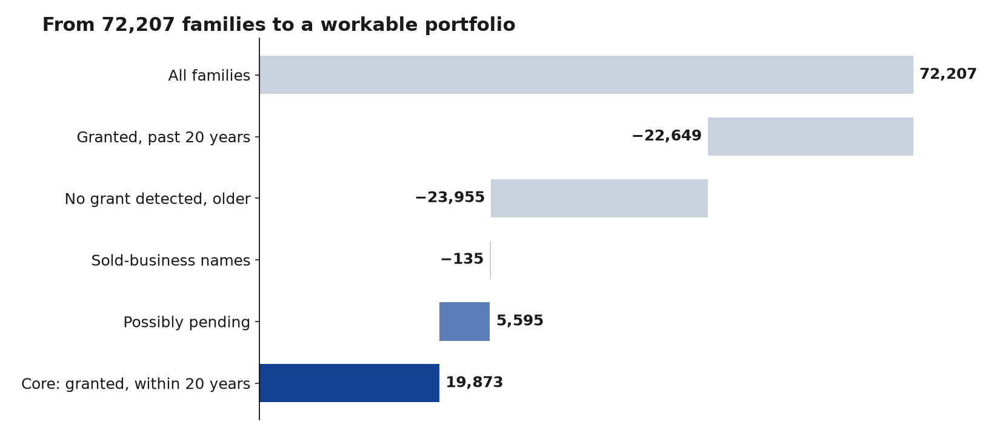
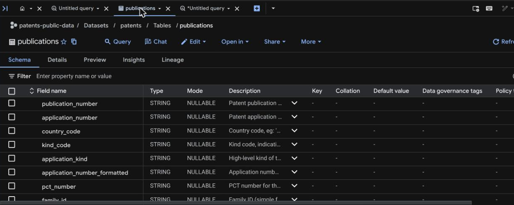
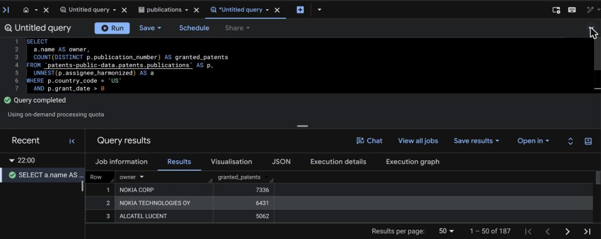
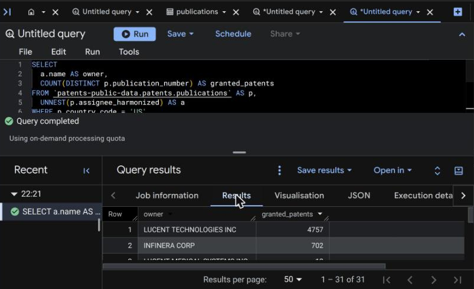
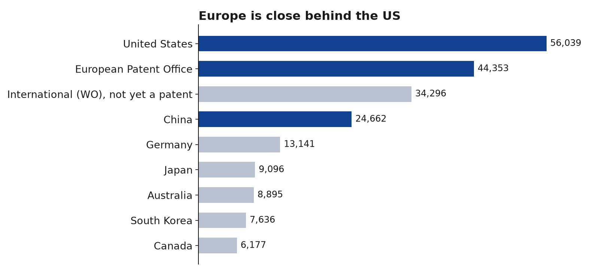

# Patent Portfolio Analysis

I saw [this traineeship posting at Nokia](https://www.linkedin.com/jobs/view/4483030441) and didn't know what patent portfolio work involves. This repo documents me teaching myself, and it's now focused on the role's Business Data Analytics track: how to allocate a limited patent budget.

**To get oriented:**
- [Working principles](docs/principles.md): the posting's expectations, how I apply them and where I fall short
- [Assumption register](docs/assumptions.md): what the analysis assumes, and what's been tested
- [Analysis strategy](docs/strategy.md): the decisions this analysis supports, and the plan
- [How my approach changed](docs/approach-changes.md): why I moved from exploring to starting with decisions
- [Twenty years of patents and money](docs/twenty-years.md): reported finances and events against the patent data
- [The workable portfolio](docs/portfolio-filter.md): how 72,207 families become about 20,000
- [Can I trust this data?](docs/data-trust.md): where it comes from, and where to find money data
- [Data map](docs/data-map.md): what the data contains, and all my questions at a glance
- [Question log](docs/questions.md): how I found each answer and what I used
- [Fact checks](docs/sources.md): the outside facts I rely on, and how well each one is supported
- [Explain it yourself](docs/explain-it.md): the calculations and questions I should be able to answer

The rest of this page walks through the work with screenshots.

This isn't affiliated with Nokia, and it uses only public data.

**Status:** I've narrowed 72,207 families filed in the last 30 years to a [workable portfolio](docs/portfolio-filter.md) of **19,873 granted families**, plus 5,595 possibly pending. Next I'm building [the budget model](docs/strategy.md): a cost forecast, keep-or-drop analysis, scenarios and sensitivities.

## What I've found so far

These are granted US patents filed since November 1996 ([recount](data/processed/us_30y_recount.csv)).

| | |
|---|---|
| **36,630** | unique patents, listed under 238 owner names |
| **93%** | of listings sit under just the top 10 names |
| **46%** | carry an Alcatel or Lucent name, from the company Nokia acquired in 2016 |
| **About 2.9** | applications per invention, worldwide |





**Main takeaway:** almost half of this US portfolio came through one acquisition, or at least still carries its names. Understanding how the company was built matters more than fixing spelling.

**Main limit:** these names show who's on each patent, not who owns it today or whether it's still in force.

## Step 1: Work out what the job actually is

The posting mentions patent costs, investment modelling, scenario analysis, and demand and capacity planning. My reading is that the team's core question is:

> Which patents are worth paying to keep, and how much should we spend?

Patents cost money to keep alive and earn money through licensing. The posting also spends a lot of time on data quality and on honest ranges rather than single numbers, so I decided to start with the data. This is my own inference from the posting, not something Nokia has told me.

## Step 2: Choose a data source

| | Google Patents Public Data | EPO PATSTAT Global |
|---|---|---|
| **Cost** | Free in the BigQuery sandbox, with 1 TB of queries a month | Paid |
| **Access** | Immediate, with SQL | Subscription, or a trial for PATSTAT Online |
| **Renewal data** | Not in the main table | Yes: `TLS231_INPADOC_LEGAL_EVENT`, `FEE_RENEWAL_YEAR`, `LAPSE_DATE` |
| **Owner names** | `assignee_harmonized` | `PSN_NAME`, `HAN_HARMONIZED` |

I chose Google so I could start straight away. I read the PATSTAT data catalog to see what the stronger source would add, and it's the natural upgrade for the European side.

## Step 3: Open the data

The main table is `patents-public-data.patents.publications`, with about 173.5 million rows and 2.88 TB. That size matters: the free allowance is 1 TB a month, so selecting only the columns I need is essential. `LIMIT` doesn't reduce what's scanned.



## Step 4: Ask a simple question first

**Question:** under which names do Nokia's granted US patents appear?

[The query](sql/01_owner_names.sql) searches owner names containing "Nokia" or "Alcatel". I included Alcatel because Nokia bought Alcatel-Lucent in 2016.



The search found 187 names ([raw results](data/raw/owner_counts.csv)).

## Step 5: Find out what the results mean

### The names reflect the company's history

These are the largest names in the corrected recount:

| Owner name | Granted US patents | What it is |
|---|---:|---|
| NOKIA CORP | 7,382 | Parent company |
| LUCENT TECHNOLOGIES INC | 7,209 | Merged into Alcatel-Lucent in 2006 |
| NOKIA TECHNOLOGIES OY | 6,457 | Nokia's technology business |
| ALCATEL LUCENT | 5,074 | Acquired by Nokia in 2016 |
| CIT ALCATEL | 2,493 | Older Alcatel name |
| NOKIA SOLUTIONS & NETWORKS OY | 2,405 | Networks business |
| NOKIA MOBILE PHONES LTD | 1,212 | Former phone business |
| NOKIA SIEMENS NETWORKS OY | 531 | Former joint venture |

The company history is in my [fact checks](docs/sources.md).

### Three kinds of mess

1. **Typos:** `NOKIA TECHNOLGIES OY`, `Nokia Technololgies Oy`, `NOKIA MOVILE PHONES LTD`, `ALCATEL LUCENT USA ZINC`.
2. **Legal forms and subsidiaries:** `NOKIA OYJ`, `NOKIA INC`, `NOKIA GMBH`. These may be real, separate entities, so merging them is a decision about the question being asked.
3. **False matches:** `NOKIAN TYRES PLC` and `NOKIAN RENKAAT OYJ` are a tyre company. A simple text search catches them, and I only saw this by reading the output.

In my first search, [`src/clean_owners.py`](src/clean_owners.py) flagged 59 of 187 names as likely variants, covering just 140 of 28,773 listings. That's a floor, because the matching misses some, such as `NOKIA CORPORTION` against the much shorter `NOKIA CORP`, and some flagged names may be real entities.

In the recount, 28 names (178 patents) are marked **Needs review**. They look like joint ownership or businesses that were sold, such as cables and optronics. [I've checked what I could](docs/sources.md#the-needs-review-names).

## Step 6: Check what the first search missed

The first search looked for "Alcatel", but Alcatel merged with Lucent in 2006, and Lucent's patents don't carry the Alcatel name. So I listed the deals I knew of and [searched for the missing companies](sql/02_lineage_names.sql).



This search taught me two more things:

- **The first search had a blind spot:** it missed 10 misspelled names like `ALCALTEL LUCENT`, because they don't contain "Alcatel".
- **Whole-word matching isn't enough:** it blocks "TRANSLUCENT", but it still finds unrelated companies like `LUCENT MEDICAL SYSTEMS` and `LUCENT BIOSCIENCES`. I marked those as unrelated by reading them, based only on their names.

## Step 7: Look beyond the US

[This query](sql/03_filings_by_country.sql) counts applications by patent office ([results](data/raw/filings_by_country.csv)).



It also taught me to distrust a column: grant dates can't be compared across countries. Japan shows 0 granted applications and Austria shows 99.8%, which says more about the data than about Nokia.

It also exposed a mistake in my earlier searches. It found 43,674 granted US applications, more than those searches did. [A check](sql/04_check_us_kind_codes.sql) confirmed that filtering on kind codes starting with B dropped 8,808 older patents, the last granted in December 2000, so I [reran the name search](sql/05_owner_names_all_years.sql) ([top 20 names](data/raw/owner_counts_all_years_top20.csv)). `LUCENT TECHNOLOGIES INC` rose from 4,757 to 9,310 patents.

## Step 8: Build a working table

I then [built my own table](sql/06_create_portfolio_30y.sql) of everything filed since November 1996, across all offices, so later questions don't have to rescan the 2.88 TB source. [A check](sql/07_check_portfolio_30y.sql) found 72,207 inventions from 212,660 applications. Citations are missing on 49% of publications, so they need care ([results](data/raw/portfolio_30y_check.csv)).

I then [recounted the US figures](sql/08_recount_us_30y.sql) from that table, which processed just 14.46 MB. That replaced the early numbers with the ones at the top of this page.

## Step 9: Change approach

At this point I was running queries without a clear purpose, so I stopped and [changed my approach](docs/approach-changes.md). The [analysis strategy](docs/strategy.md) now centres on one problem: how to allocate a limited patent budget.


## What these numbers can't tell you

- **This isn't Nokia's current portfolio.** It includes patents that have expired or lapsed, and it shows the name on the patent, which may be out of date after a sale or transfer.
- **Listings aren't unique patents.** A patent with two owners counts under both, which is why there are 37,710 listings for 36,630 patents.
- **Lucent's name doesn't prove Nokia ownership.** Lucent spun off Avaya and Agere, which may have taken patents with them.
- **The name searches are US-only.** Step 7 shows how much sits elsewhere.
- **Family assignments are my judgement.** They need checking against company records.

## Next steps

The plan is in the [analysis strategy](docs/strategy.md), and smaller open questions are in the [question log](docs/questions.md#open).

## Run it yourself

```bash
python src/clean_owners.py
python src/clean_lineage.py
python src/check_outputs.py
pip install matplotlib
python src/make_charts.py
python src/make_data_map.py
python src/make_scale_charts.py
python src/make_twenty_years_chart.py
```

To get Nokia's annual reports, set your own contact, as the SEC requires one:

```bash
SEC_USER_AGENT="Your Name you@example.com" python src/download_annual_reports.py
```

The reports stay out of the repo because of their size, and [the manifest](data/raw/annual_reports_manifest.csv) records each file's source and fingerprint.

The queries are in [`sql/`](sql), numbered in the order I ran them. The working table expires after 60 days in the BigQuery sandbox, so rerun [the build query](sql/06_create_portfolio_30y.sql) to restore it.

## How this was made

I chose the question and data sources, ran the queries in BigQuery and reviewed the results. I used Claude (AI) to help interpret the output, write the scripts and draft this document.
