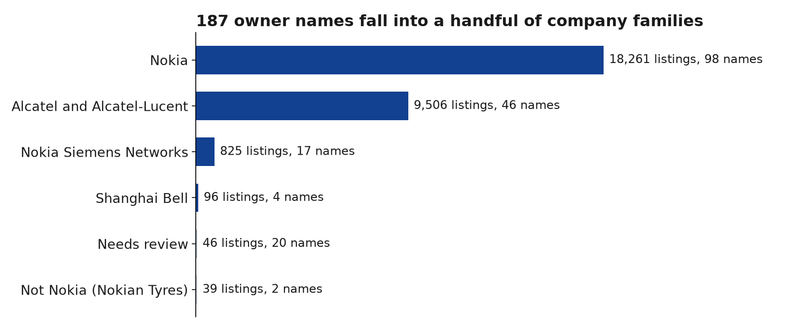
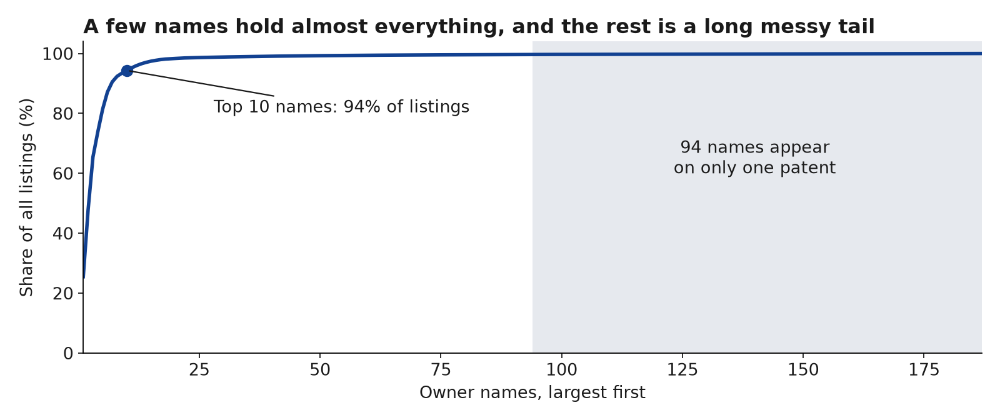
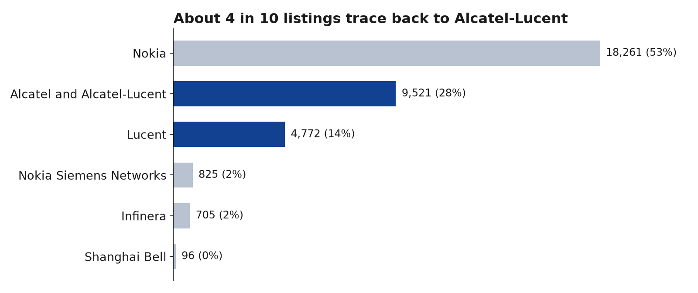

# Patent Portfolio Analysis

I saw a job posting for a patent portfolio trainee at Nokia and didn't know what that work involves. This repo documents me teaching myself: finding the tools, picking interesting questions, and recording how I found each answer and which resources I used.

**To get oriented:**
- [Data map](docs/data-map.md): what the data contains, and all my questions at a glance
- [Question log](docs/questions.md): how I found each answer and what I used

The rest of this page walks through the work with screenshots.

This isn't affiliated with Nokia, and it uses only public data.

**Status:** nine questions answered. **Known issue:** the US totals below leave out 8,808 older patents, and I'm rerunning them for the last 30 years (Q15 in the log).

## What I've found so far

The US figures below come from a search that missed older patents, so they will change.

| | |
|---|---|
| **187, then 218** | owner names found, once a second search added the companies Nokia absorbed |
| **94%** | of listings sit under just the top 10 names |
| **About 4 in 10** | listings trace back to Alcatel and Lucent, which Nokia acquired as Alcatel-Lucent |
| **32% of names, 0.5% of listings** | the share of names that look like spelling or legal-form variants |
| **39** | listings that matched "Nokia" but belong to Nokian Tyres |

**Main takeaway:** the typos are easy to spot, but they barely change the totals. Knowing how the company is built, and which business lines it sold, matters far more.

## Step 1: Work out what the job actually is

The posting mentions patent costs, investment modelling, scenario analysis, and demand and capacity planning. My reading is that the team's core question is:

> Which patents are worth paying to keep, and how much should we spend?

Patents cost money to keep alive and earn money through licensing. The posting also spends a lot of time on data quality and on honest ranges rather than single numbers, so I decided to start with the data. This is my own inference from the posting, not something Nokia has told me.

## Step 2: Choose a data source

| | Google Patents Public Data | EPO PATSTAT Global |
|---|---|---|
| **Cost** | Free in the BigQuery sandbox, with 1 TB of queries a month | Paid |
| **Access** | Immediate, with SQL | Subscription, or a trial for PATSTAT Online |
| **Renewal data** | Not in the main table | Yes: `TLS231_INPADOC_LEGAL_EVENT`, `FEE_RENEWAL_YEAR`, `LAPSE_DATE` |
| **Owner names** | `assignee_harmonized` | `PSN_NAME`, `HAN_HARMONIZED` |

I chose Google so I could start straight away. I read the PATSTAT data catalog to see what the stronger source would add, and it's the natural upgrade for the European side.

## Step 3: Open the data

The main table is `patents-public-data.patents.publications`, with about 173.5 million rows and 2.88 TB. That size matters: the free allowance is 1 TB a month, so selecting only the columns I need is essential. `LIMIT` doesn't reduce what's scanned.


## Step 4: Ask a simple question first

**Question:** under which names do Nokia's granted US patents appear?

[The query](sql/01_owner_names.sql) searches owner names containing "Nokia" or "Alcatel". I included Alcatel because Nokia bought Alcatel-Lucent in 2016.


I expected a short list and got 187 names ([raw results](data/raw/owner_counts.csv)).

## Step 5: Find out what the results mean

### The names reflect the company's history

Some of the largest names:

| Owner name | Granted US patents | What I think it is |
|---|---:|---|
| NOKIA CORP | 7,336 | Parent company |
| NOKIA TECHNOLOGIES OY | 6,431 | Technology and licensing company |
| ALCATEL LUCENT | 5,062 | Acquired in 2016 |
| NOKIA SOLUTIONS & NETWORKS OY | 2,401 | Networks business |
| CIT ALCATEL | 2,188 | Older Alcatel name |
| NOKIA MOBILE PHONES LTD | 977 | Former phone business |
| NOKIA SIEMENS NETWORKS OY | 531 | Former joint venture |

### Sorting them into families

[`src/clean_owners.py`](src/clean_owners.py) sorts every name into a family using simple rules, with the results in [`owner_mapping.csv`](data/processed/owner_mapping.csv).



### A few names hold almost everything



### Three kinds of mess

1. **Typos:** `NOKIA TECHNOLGIES OY`, `Nokia Technololgies Oy`, `NOKIA MOVILE PHONES LTD`, `ALCATEL LUCENT USA ZINC`.
2. **Legal forms and subsidiaries:** `NOKIA OYJ`, `NOKIA INC`, `NOKIA GMBH`. These may be real, separate entities, so merging them is a decision about the question being asked.
3. **False matches:** `NOKIAN TYRES PLC` and `NOKIAN RENKAAT OYJ` are a tyre company. A simple text search catches them, and I only saw this by reading the output.

The script flags 59 names as likely variants, covering 140 listings. That's a floor, because the matching misses some, such as `NOKIA CORPORTION` against the much shorter `NOKIA CORP`, and some flagged names may be real entities.

A further 20 names (46 listings) are marked **Needs review**. They look like joint ownership or businesses that may have been sold, such as cables and optronics. I haven't verified their histories.

## Step 6: Check what the first search missed

The first search looked for "Alcatel", but Alcatel merged with Lucent in 2006, and Lucent's patents don't carry the Alcatel name. So I listed the deals I knew of and [searched for the missing companies](sql/02_lineage_names.sql).




This search taught me two more things:

- **The first search had a blind spot:** it missed 10 misspelled names like `ALCALTEL LUCENT`, because they don't contain "Alcatel".
- **Whole-word matching isn't enough:** it blocks "TRANSLUCENT", but it still finds unrelated companies like `LUCENT MEDICAL SYSTEMS` and `LUCENT BIOSCIENCES`. I marked those as unrelated by reading them, based only on their names.

## Step 7: Look beyond the US

[This query](sql/03_filings_by_country.sql) counts applications by patent office ([results](data/raw/filings_by_country.csv)).


It also taught me to distrust a column: grant dates can't be compared across countries. Japan shows 0 granted applications and Austria shows 99.8%, which says more about the data than about Nokia.

It also exposed a mistake in my earlier searches. It found 43,674 granted US applications, more than those searches did. [A check](sql/04_check_us_kind_codes.sql) confirmed that filtering on kind codes starting with B dropped 8,808 older patents, the last granted in December 2000, so I'm [rerunning the name search](sql/05_owner_names_all_years.sql).

## What these numbers can't tell you

- **This isn't Nokia's current portfolio.** It includes expired patents and shows the name on the patent, which may be out of date after a sale or transfer.
- **Listings aren't unique patents.** A patent with two owners counts under both, so the 34,229 total is too high.
- **Lucent's name doesn't prove Nokia ownership.** As far as I remember, Lucent spun off Avaya and Agere, which may have taken patents with them.
- **The name searches are US-only.** Step 7 shows how much sits elsewhere.
- **Family assignments are my judgement.** They need checking against company records.

## Next steps

The open questions are in the [question log](docs/questions.md#open).

## Run it yourself

```bash
python src/clean_owners.py
python src/clean_lineage.py
pip install matplotlib && python src/make_charts.py
```

To refresh the raw data, run [the SQL](sql/01_owner_names.sql) in BigQuery and export it to `data/raw/owner_counts.csv`.

## How this was made

I chose the question and data sources, ran the queries in BigQuery and reviewed the results. I used Claude (AI) to help interpret the output, write the scripts and draft this document.
