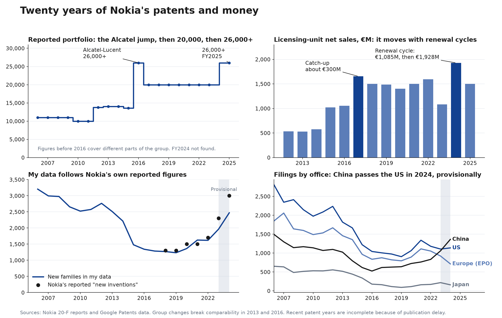

# Patent Portfolio Analysis

**I'm doing this project to apply for Nokia's [Financial Data Engineering / Business Data Analytics Trainee — Patent Portfolio Management](https://www.linkedin.com/jobs/view/4483030441) traineeship, in the Business Data Analytics track.**

This isn't affiliated with Nokia, and it uses only public data.

## Central research question

> How does Nokia's patent portfolio and associated investment position compare with the leading competitors in AI and cloud infrastructure networking, and what strategic and financial lessons can be identified?

I didn't know what patent portfolio work involves, so this repo documents me teaching myself. After a couple of hours of exploring the data, testing questions and learning the field, I'd learned enough to zoom in on this question.

## Where it stands

| Step | Status |
|---|---|
| [Nokia base](docs/portfolio-filter.md): filtered portfolio and [20 years of finances](docs/twenty-years.md) | Built, with lapsed and sold patents still to remove |
| [Market leaders](docs/competitors.md): verified comparison set | Checked |
| Patent comparison against Ciena, Cisco and Arista, with Huawei as a benchmark | **Next** |
| Investment comparison: rivals' R&D and AI and cloud figures | Not started |
| [Budget model](docs/strategy.md): costs, scenarios, sensitivity and a probability curve | Partly started, needs USPTO renewal records |
| Decision brief: up to five findings, each with a decision | Not started |

**There's no answer to the central question yet.** The results below are the groundwork, and the patent comparison is still to come.

## What I've found so far

### No single company leads AI and cloud networking

Nokia's strongest public positions are in optical. Market share doesn't show who has the stronger patents, which is what I'm testing next.


### The workable portfolio is about 20,000 families

Nokia reports 26,000+ families, and my total including possibly pending ones is 25,468. Lapsed and sold patents are still included.


### 46% of US patents filed since 1996 carry an Alcatel or Lucent name

That's across 36,630 unique patents, so any cost or renewal analysis needs to report them separately. These names show who's on each patent, not who owns it today or whether it's still in force.


### The patent data tracks Nokia's reported figures

New families follow Nokia's reported new inventions, and licensing sales swing with renewal cycles, from €1,085M in 2023 to €1,928M in 2024.



### Renewal fees alone look small

A rough check puts official US renewal fees at about $14.5M–$18.8M a year, or roughly 1% of licensing-unit sales. Other offices and filing and attorney costs [aren't included yet](docs/strategy.md#early-answer-are-fees-big-enough-to-matter).

## How I work

- **Combining sources:** patent records, Nokia's annual reports, competitor and market data, and official fees
- **Verifying outputs:** cross-checks between sources, automatic checks and a record of what's still unverified
- **Using AI to move faster:** AI-accelerated search and analysis, with standard data handling and me directing the work
- **Building my own method:** a repeatable approach for my analytics and education
- **Learning quickly:** picking up new concepts and turning them into structured analysis
- **Directing my own research:** changing approach when something isn't working, and choosing where to spend my effort

## Guide to the repo

**The analysis**
- [Research design](docs/research-design.md): hypotheses and reliability rules for the central question
- [Analysis strategy](docs/strategy.md): the plan, and the financial analysis
- [Who leads AI and cloud networking?](docs/competitors.md): verified market positions and the comparison set
- [Twenty years of patents and money](docs/twenty-years.md): reported finances and events against the patent data
- [The workable portfolio](docs/portfolio-filter.md): how 72,207 families were narrowed

**Reliability**
- [Assumption register](docs/assumptions.md): what the analysis assumes, and what's been tested
- [Can I trust this data?](docs/data-trust.md): where it comes from, and where to find money data
- [Fact checks](docs/sources.md): the outside facts I rely on, and how well each one is supported
- [Working principles](docs/principles.md): the posting's expectations, how I apply them and where I fall short

**How I learned**
- [How I got here](docs/how-i-got-here.md): each step with screenshots, including mistakes
- [How my approach changed](docs/approach-changes.md): why I moved from exploring to testing hypotheses
- [Question log](docs/questions.md): how I found each answer and what I used
- [Data map](docs/data-map.md): what the data contains, and what's missing
- [Explain it yourself](docs/explain-it.md): the calculations and questions I should be able to answer

## Run it yourself

```bash
python src/clean_owners.py
python src/clean_lineage.py
python src/check_outputs.py
pip install matplotlib
python src/make_charts.py
python src/make_data_map.py
python src/make_scale_charts.py
python src/make_twenty_years_chart.py
python src/make_competitor_chart.py
```

To get Nokia's annual reports, set your own contact, as the SEC requires one:

```bash
SEC_USER_AGENT="Your Name you@example.com" python src/download_annual_reports.py
```

The reports stay out of the repo because of their size, and [the manifest](data/raw/annual_reports_manifest.csv) records each file's source and fingerprint.

The queries are in [`sql/`](sql), numbered in the order I ran them. The working table expires after 60 days in the BigQuery sandbox, so rerun [the build query](sql/06_create_portfolio_30y.sql) to restore it.

## How this was made

I chose the question and data sources, ran the queries in BigQuery and reviewed the results. I used Claude (AI) to help interpret the output, write the scripts and draft this document.
