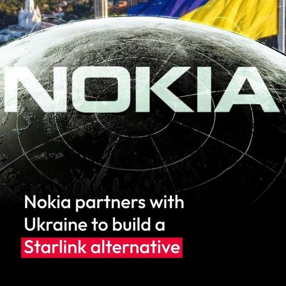
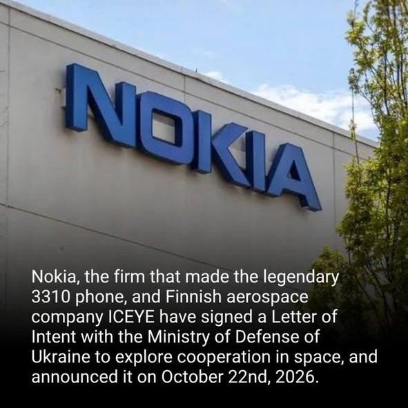
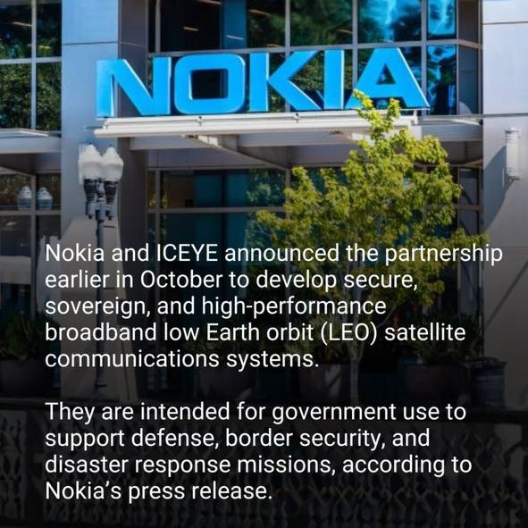

# Pivot: sovereign satellite communications

**Date:** 2 November 2026
**Status:** Executed. The central question was rewritten across the repository on the same day (checklist item 2 done). Code pools (item 1) are the next step.

## Trigger

On 22 October 2026, ICEYE and Nokia signed a Letter of Intent with the Ministry of Defence of Ukraine to explore cooperation in space — sovereign, secure LEO satellite communications for defence, border security and disaster response ([Nokia press release via Yahoo Finance](https://uk.finance.yahoo.com/news/iceye-nokia-partner-ministry-defence-175200661.html), [Militarnyi](https://militarnyi.com/en/news/ukraine-iceye-and-nokia-join-forces-to-develop-indigenous-satellite-communications-system/), [The Defense Post](https://thedefensepost.com/2026/10/27/ukraine-sovereign-satcom-system/amp/)). This followed the ICEYE–Nokia strategic partnership announced on 6 October 2026 to develop sovereign satellite communications for government and defence customers, targeting a LEO constellation by 2028 ([Israel Defense](https://www.israeldefense.co.il/en/node/71424)).

This is a verified public fact. What a Letter of Intent will become — contract, programme, cancellation — is unknown and must not be treated as revenue.

How the news reached me (via [Cybernews](https://cybernews.com/tech/nokia-ukraine-starlink/) on Instagram, 24 October 2026):

  
  
  

The cropped originals, kept as the discovery record: [headline](assets/pivot-trigger-1-headline.jpg), [LoI](assets/pivot-trigger-2-loi.jpg), [partnership](assets/pivot-trigger-3-partnership.jpg).

The screenshots are the discovery record; the press release and reporting linked above are the evidence. Broader context — including the 14–24 October Starshield restriction that preceded the LoI, what each partner brings, and the Starlink / OneWeb / IRIS² landscape — is in the imported [deep-research report](../appendices/deep-research-ukraine-satcom.md), with its key claims status-tagged in [sources.md](../appendices/sources.md#sovereign-satcom-context-post-pivot).

## New central question (adopted)

> Which technological capabilities, patent assets and investment priorities are most important for developing a sovereign LEO satellite communications capability for Ukraine and European government customers?

Adopted 2 November 2026. The canonical question lives in `config/research_parameters.toml` and is enforced by `tests/test_repository.py`; the rewrite covered the config, README, research design, research questions, scope and the assumptions register in one pass, with the consistency test green. Sharpened 9 November 2026 into the build–buy–partner–license framing; the wording above is the 2 November adoption, kept as the record.

## What the analysis will be used for

1. **The application work sample.** Same vacancy, same standard: a defensible, reproducible, outside-in analysis. The pivot itself is evidence — recognising a material strategic event and re-aiming the research within days.
2. **The actual analysis.** Map Nokia's publicly observable patent position in satellite communications (payloads, inter-satellite links, ground segment, secure waveforms, network integration), benchmark it against the actors that matter in sovereign satcom, and ask what Nokia has, what ICEYE adds, and where the gaps are.
3. **A living portfolio.** The repo stays honest: this document records the pivot, the old question stays in the change history, nothing is silently rewritten.

## What survives the pivot

- The entire pipeline: BigQuery dataset, entity resolution, family building, grant-evidence logic, validation method, cost model framework.
- The five-question structure (position → comparison → business fit → cost → priorities) — the questions get re-aimed, not replaced.
- The honesty machinery: evidence labels, assumptions register, precision bar, tests.
- The Alcatel/Lucent lineage work — Nokia Bell Labs and legacy satellite-adjacent research still flow through the same lineage.

## What changes

| Element | Was | Becomes |
|---|---|---|
| Technology categories | OPT / IPR / DCS | New satcom code pools (e.g. H04B 7/185 satellite comms, H04K/H04L security, plus ground-segment and optical inter-satellite link codes — to be defined from CPC, not guessed) |
| Peers | Ciena, Cisco, Arista, Huawei | Rethought per category: ICEYE (partner, not peer), Eutelsat/OneWeb, Viasat, Thales Alenia Space, Airbus Defence and Space; SpaceX noted as the dominant actor with limited patent transparency |
| H1–H4 | Optical/routing/switching hypotheses | Retired to the log; new hypotheses drafted after the code pools exist |
| Classification validation | 300-family sample in OPT/IPR/DCS | New sample in the new categories — nothing carries over as validated |
| Infinera analysis | H1 driver | Becomes background; still answers "what Nokia bought in optical transport," which feeds ground-segment backhaul |

## What this pivot must not do

- Treat the Letter of Intent as a contract, programme or revenue.
- Assume Nokia's satcom patent position is strong (or weak) before measuring it.
- Reuse the OPT/IPR/DCS precision results as if they validate satcom classification.
- Drop the old work as wasted: the pipeline, the validation method and the financial model are exactly what the new question needs.

## Checklist to execute the pivot

1. Define satcom CPC/IPC code pools from the classification schedules, with sources.
2. Rewrite the central question in `config/research_parameters.toml`, README and research design in one pass; keep the consistency test green.
3. Re-aim RQ1–RQ5 and retire H1–H4 to this log.
4. Run pool counts for Nokia, ICEYE and the new peer set in BigQuery.
5. New validation sample before any comparative claim.
6. Update README status table and the executive brief.
