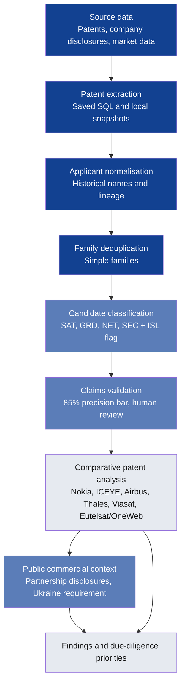

# Research design

This is the authoritative protocol for the project. The [scope](scope.md) and [research questions](research-questions.md) sit beside it, and progress is tracked only in the [evidence tracker](../appendices/evidence-gaps.md).

## Central research question

> **What can Nokia and ICEYE realistically reuse from their existing technology assets to deliver a sovereign satellite communications system, and what must they develop, acquire or obtain from other partners?**

Adopted 24 November 2026. This is the third wording: the [2 November 2026 pivot](pivot-sovereign-satcom.md) moved the project from optical/routing/switching to sovereign satcom, and the 9 November rebuild wrapped it in a build–buy–partner–license framing with investment rankings. That version was retired because it outran the evidence: public patent data cannot rank a company's internal investment priorities, and the five-pool classification [failed its own validation bar](../02-methodology/satcom-validation-plan.md) on 13 November. The re-aimed question asks only what public evidence can actually support: what exists, what can be reused, and where the dependencies are. The retirement is recorded in the [research log](../appendices/research-log.md).

## Project definition

| Item | Value |
|---|---|
| **Business question** | What existing technology and intellectual-property assets can Nokia and ICEYE potentially leverage for sovereign LEO communications, and what dependencies or uncertainties should be investigated before commercial deployment? |
| **Anchor customer case** | Ukraine's sovereign satellite communications requirement (Letter of Intent with the Ministry of Defence, 22 October 2026), with European government customers as the wider market |
| **Perspective** | Independent, outside-in business and patent intelligence. Not affiliated with Nokia |
| **Intended audience** | Investment and patent portfolio management; technology strategy stakeholders |
| **Decision supported** | Prioritise technology and IP due diligence — not engineering choices, and not investment decisions on Nokia's behalf |
| **Evidence boundary** | Public patent records, company disclosures, official filings and published market information |

## Research basis and limitations

This is an independent, outside-in assessment based only on publicly available patent, commercial, technological and financial information.

It examines Nokia's and ICEYE's observable patent portfolios, technology positions, competitor activity and commercial developments. It has no access to Nokia's internal patent spending, portfolio valuations, confidential licensing agreements or R&D investment decisions — and no access to the partnership's undisclosed division of engineering work or IP ownership. So findings and recommendations are evidence-based assessments and hypotheses, not definitive evaluations of anyone's internal strategy.

| Level | What it can do | Status |
|---|---|---|
| **Public data** | Patent position, technology trends, competitor activity, geographic coverage, commercial indicators | This project |
| **Internal data** | Actual spending, real costs, licensing terms, engineering readiness and business cases | Needs access to the companies' systems |

Three evidence layers are kept separate throughout: what the companies publicly disclose (cited sources), what the patent data shows (reproducible datasets), and what this project infers (documented reasoning). An inference is never stated as a disclosure or a data fact.

## How the work fits together

Dark blue is built, mid blue is partly done, and grey isn't started. [`src/run_all.py`](../../src/run_all.py) reruns every local step, and [`sql/README.md`](../../sql/README.md) records the BigQuery steps.

## What we can investigate with actual data

| Analysis | What it could reveal | Where it runs |
|---|---|---|
| Patent landscape | Who holds relevant satellite communications technology | BigQuery patent data, satcom code pools, [`sql/`](../../sql/README.md) queries 23–36 |
| Nokia and ICEYE vs. competitors | Where each actor has observable strengths or gaps | Pool counts by company from the [peers table](../../sql/24_satcom_peers_30y.sql), after validation |
| NTN and LEO filing trends | Which technologies are attracting increasing patent activity | Priority-year series per code pool, 2020–2024 main period |
| Ground segment and security | Which capabilities are needed beyond the satellites themselves | Separate ground-segment and security code pools, so space and ground are counted apart |
| Patent ownership and legal status | Which assets rest on reliable ownership and status evidence | The [five evidence levels](../02-methodology/candidate-portfolio-universe.md#what-each-data-category-establishes), plus USPTO maintenance-fee events once downloaded |
| Ukraine's domestic position | Whether any Ukrainian-held satcom patent base exists | [Queries 25–29](../../sql/README.md) — answered: no corporate base, 16 foreign families ever filed at the Ukrainian office |

## Where each part lives

| Part | Document |
|---|---|
| Technology, companies, offices and dates | [Scope](scope.md) |
| Three research questions and hypotheses | [Research questions](research-questions.md) |
| What counts as satcom technology | [Classification codebook](../02-methodology/classification-codebook.md) and [code pools](satcom-code-pools.md) |
| Whether those labels can be trusted | [Validation](../02-methodology/validation.md) and the [satcom validation plan](../02-methodology/satcom-validation-plan.md) |
| What the patent counts do and don't establish | [Candidate portfolio universe](../02-methodology/candidate-portfolio-universe.md) |
| Where the data comes from and how far to trust it | [Data quality and lineage](../02-methodology/data-quality-and-lineage.md) |
| How each measure is defined | [Metrics](../02-methodology/metrics.md) |
| Results so far | [Findings](../05-findings-and-recommendations/findings.md) |
| Pre-pivot market and patent analysis | [Archived](../../archive/pre-pivot/) as the method demonstration, not current findings |
| Ten-year maintenance cost model | [Parked](../../archive/parked-financial-analysis/) as a separate financial-methodology exercise |

## What I'm avoiding

| Avoid | Instead |
|---|---|
| Ranking companies by total patents | Compare relevant families by technology, after validation |
| Inferring investment priorities from patent counts | Flag due-diligence priorities; investment decisions need internal data |
| Reading absence of patents as absence of capability | State the caveat wherever a portfolio looks thin (ICEYE, SpaceX, Ukraine) |
| Reading the partners' patent profiles as the partnership's IP division | The actual division of engineering and IP ownership is undisclosed — treat it as unknown |
| Treating an applicant name as current ownership | Use the [five evidence levels](../02-methodology/candidate-portfolio-universe.md#what-each-data-category-establishes) |
| Calling a family an active Nokia asset because of its age | Confirm live status and owner in a register |
| Treating citations as value | Use them as one indicator of influence |
| Treating filings as commercial success | Compare with market performance from separate sources |
| Firm conclusions from recent records | Allow for publication and legal-status delays |
| Statistical tests because the tooling exists | [Pre-registered hypotheses](satcom-hypotheses.md) with a data-tier gate; unvalidated counts never enter a significance test |

## Reliability checks

Every finding has to pass these checks. The thresholds are my own working standards, not an industry rule.

| Check | Pass rule | Status |
|---|---|---|
| **Classification** | At least 85% precision per label, kappa of at least 0.7, and recall reported | Pre-pivot pools [failed](../02-methodology/validation.md#precision-result); satcom re-test failed at 70.8% on 13 November. Agreement and recall not done |
| **Applicant matching** | Review the top names for each company, and spot-check a sample against registers | Satcom names reviewed except [11 flagged names](../../data/interim/satcom_name_review.csv). [Spot-check](../../data/validation/spot_check_sample.csv) not done |
| **Ownership** | Current owner supported by assignment or register evidence | Not done. [Early warning](../02-methodology/candidate-portfolio-universe.md#current-owner-evidence-so-far) |
| **Robustness** | Same direction under a second technology definition | Not done |
| **Unit** | Same direction in families and in US grants | Not done |
| **Time** | Use 2020–2024 as the main period, and treat 2025–2026 as provisional | Rule set |
| **Independent check** | Compare with company reports or other outside evidence | Partly done, for new families |

## How to state an answer

1. **Answer:** one sentence
2. **Evidence:** the numbers and sources
3. **Confidence:** high, medium or low, with the reason
4. **What would change it:** the result or data that would overturn it
5. **Decision:** what to do, investigate or stop doing

## Rules that stop endless metric-pulling

Before running a query, I write down the hypothesis or deliverable it feeds, the decision it informs, the measure, what result would change my mind, and the main data limit. If it doesn't feed one, the query doesn't get run.

- A chart only goes in if it supports, disproves or qualifies a hypothesis.
- The project ends with at most five findings per research question, and a stated decision for each.
- "The data can't answer this" is a valid result.
- When a decision wouldn't change with more data, the analysis stops.

## The role this project targets

The [Financial Data Engineering / Business Data Analytics Trainee posting](https://www.linkedin.com/jobs/view/4483030441) at Nokia, in the Business Data Analytics track.

| What the role does | Where it shows up here | Status |
|---|---|---|
| Analyse patent portfolio and financial data | [Findings](../05-findings-and-recommendations/findings.md) and the [pre-pivot patent landscape](../../archive/pre-pivot/patent-landscape.md) as method demonstration | Partly done |
| Investment modelling | [Ten-year model](../../archive/parked-financial-analysis/ten-year-maintenance-cost-model.md) and [US break-even](../../archive/parked-financial-analysis/us-renewal-break-even.md) | Parked; break-even done, model designed |
| Cost-efficiency studies | Statutory cost per national right, by office and scenario | Not started |
| Scenario analysis | [Maintenance scenarios](../../archive/parked-financial-analysis/assumptions-and-scenarios.md#scenarios) | Parked |
| Business cases | One recommendation with costs, benefits and risks | Not started |
| Presenting findings and reliability | [Findings](../05-findings-and-recommendations/findings.md), with ranges, assumptions and limits | Started |
