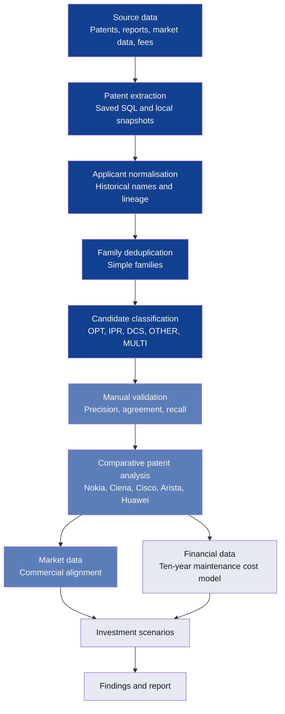

# Research design

This is the authoritative protocol for the project. The [scope](scope.md) and [research questions](research-questions.md) sit beside it, and progress is tracked only in the [evidence tracker](../appendices/evidence-gaps.md).

## Central research question

> **Which patented technologies does the proposed sovereign satellite communications system need, and where should Nokia and ICEYE build, buy, partner or license each one?**

Adopted 2 November 2026 in the [pivot to sovereign satellite communications](pivot-sovereign-satcom.md), and sharpened 9 November 2026 into the build–buy–partner–license framing. The pipeline diagram below shows the method as built and tested on optical networking, IP routing and data-centre switching; the technology categories, comparators and hypotheses are being re-aimed per the pivot checklist.

## Research basis and limitations

This is an independent, outside-in assessment based only on publicly available patent, commercial, technological and financial information.

It examines Nokia's observable patent portfolio, technology position, competitor activity, commercial developments and publicly reported financial indicators. It has no access to Nokia's internal patent spending, portfolio valuations, confidential licensing agreements or R&D investment decisions. So findings and recommendations are evidence-based assessments and hypotheses, not definitive evaluations of Nokia's internal portfolio strategy.

| Level | What it can do | Status |
|---|---|---|
| **Public data** | Patent position, technology trends, competitor activity, geographic coverage, commercial indicators, and statutory fee estimates | This project |
| **Internal data** | Actual spending, efficiency, real forecasts and business cases | Needs access to Nokia's systems |

## How the work fits together

Dark blue is built, mid blue is partly done, and grey isn't started. [`src/run_all.py`](../../src/run_all.py) reruns every local step, and [`sql/README.md`](../../sql/README.md) records the BigQuery steps.

## What we can investigate with actual data

| Analysis | What it could reveal | Where it runs |
|---|---|---|
| Patent landscape | Who holds relevant satellite communications technology | BigQuery patent data, same extraction pipeline as [`sql/`](../../sql/README.md), with new satcom code pools |
| Nokia vs. competitors | Where Nokia has technological strengths or gaps, and what ICEYE adds | Pool counts by company, as in [`sql/20_category_period.sql`](../../sql/20_category_period.sql), re-aimed at the new peer set |
| NTN and LEO filing trends | Which technologies are attracting increasing patent activity | Priority-year series per code pool, same period logic as the pre-pivot pools |
| Ground infrastructure and security | Which capabilities are needed beyond the satellites themselves | Separate ground-segment and security code pools, so space and ground are counted apart |
| Patent ownership and legal status | Which assets are actually supported by reliable ownership and status evidence | The [five evidence levels](../02-methodology/candidate-portfolio-universe.md#what-each-data-category-establishes), plus USPTO maintenance-fee events once downloaded |
| Financial and business analysis | What investment and market considerations matter for a sovereign system | [Ten-year maintenance cost model](../04-financial-analysis/ten-year-maintenance-cost-model.md), [assumptions and scenarios](../04-financial-analysis/assumptions-and-scenarios.md), twenty years of annual reports |

## Where each part lives

| Part | Document |
|---|---|
| Technology, companies, offices and dates | [Scope](scope.md) |
| Five research questions and hypotheses | [Research questions](research-questions.md) |
| What counts as optical, routing or switching | [Classification codebook](../02-methodology/classification-codebook.md) |
| Whether those labels can be trusted | [Validation](../02-methodology/validation.md) |
| What the patent counts do and don't establish | [Candidate portfolio universe](../02-methodology/candidate-portfolio-universe.md) |
| Where the data comes from and how far to trust it | [Data quality and lineage](../02-methodology/data-quality-and-lineage.md) |
| How each measure is defined | [Metrics](../02-methodology/metrics.md) |
| Market positions and company selection | [Market context and peer selection](../03-market-and-patent-analysis/market-context-and-peer-selection.md) |
| Patent comparison | [Patent landscape](../03-market-and-patent-analysis/patent-landscape.md) |
| Patents against business growth | [Commercial alignment](../03-market-and-patent-analysis/commercial-alignment.md) |
| Costs | [Ten-year maintenance cost model](../04-financial-analysis/ten-year-maintenance-cost-model.md) |
| Assumptions and scenarios | [Assumptions and scenarios](../04-financial-analysis/assumptions-and-scenarios.md) |
| Results so far | [Findings](../05-findings-and-recommendations/findings.md) |

## What I'm avoiding

| Avoid | Instead |
|---|---|
| Ranking companies by total patents | Compare relevant families by technology |
| Treating every data centre patent as AI-related | Use the [AI and cloud relevance score](../02-methodology/classification-codebook.md#secondary-fields) |
| Treating an applicant name as current ownership | Use the [five evidence levels](../02-methodology/candidate-portfolio-universe.md#what-each-data-category-establishes) |
| Calling a family an active Nokia asset because of its age | Confirm live status and owner in a register |
| Treating citations as value | Use them as one indicator of influence |
| Treating filings as commercial success | Compare with market performance from separate sources |
| Ranking companies by R&D figures with different boundaries | Use them as [commercial context](../03-market-and-patent-analysis/market-context-and-peer-selection.md#commercial-context) |
| Dividing revenue by patent costs or families | No such ratio is used, as it doesn't establish efficiency or value |
| Firm conclusions from recent records | Allow for publication and legal-status delays |

## Reliability checks

Every finding has to pass these checks. The thresholds are my own working standards, not an industry rule.

| Check | Pass rule | Status |
|---|---|---|
| **Classification** | At least 85% precision per label, kappa of at least 0.7, and recall reported | [Precision failed in every pool](../02-methodology/validation.md#precision-result). Agreement and recall not done |
| **Applicant matching** | Review the top names for each company, and spot-check a sample against registers | Names reviewed. [Spot-check](../../data/validation/spot_check_sample.csv) not done |
| **Ownership** | Current owner supported by assignment or register evidence | Not done. [Early warning](../02-methodology/candidate-portfolio-universe.md#current-owner-evidence-so-far) |
| **Robustness** | Same direction under a second technology definition | Not done |
| **Unit** | Same direction in families and in US grants | Not done |
| **Time** | Use 2020–2024 as the main period, and treat 2025–2026 as provisional | Rule set |
| **Independent check** | Compare with company reports or other outside evidence | Partly done, for new families |

## How to state an answer

1. **Answer:** one sentence
2. **Evidence:** the numbers and sources
3. **Confidence:** high, medium or low, with the reason
4. **What would change it:** the result or data that would overturn it
5. **Decision:** what to do, investigate or stop doing

## Rules that stop endless metric-pulling

Before running a query, I write down the hypothesis or deliverable it feeds, the decision it informs, the measure, what result would change my mind, and the main data limit. If it doesn't feed one, the query doesn't get run.

- A chart only goes in if it supports, disproves or qualifies a hypothesis.
- The project ends with at most five findings per research question, and a stated decision for each.
- "The data can't answer this" is a valid result.
- When a decision wouldn't change with more data, the analysis stops.

## The role this project targets

The [Financial Data Engineering / Business Data Analytics Trainee posting](https://www.linkedin.com/jobs/view/4483030441) at Nokia, in the Business Data Analytics track.

| What the role does | Where it shows up here | Status |
|---|---|---|
| Analyse patent portfolio and financial data | [Patent landscape](../03-market-and-patent-analysis/patent-landscape.md) and [twenty years of reported figures](../03-market-and-patent-analysis/twenty-years.md) | Partly done |
| Investment modelling | [Ten-year model](../04-financial-analysis/ten-year-maintenance-cost-model.md) and [US break-even](../04-financial-analysis/us-renewal-break-even.md) | Break-even done, model designed |
| Cost-efficiency studies | Statutory cost per national right, by office and scenario | Not started |
| Scenario analysis | [Maintenance scenarios and investment strategies](../04-financial-analysis/assumptions-and-scenarios.md#scenarios) | Defined |
| Business cases | One recommendation with costs, benefits and risks | Not started |
| Demand and capacity planning | [Filing and renewal volumes against team hours](../04-financial-analysis/assumptions-and-scenarios.md#capacity-plan) | Not started |
| Presenting findings and reliability | [Findings](../05-findings-and-recommendations/findings.md), with ranges, assumptions and limits | Started |
