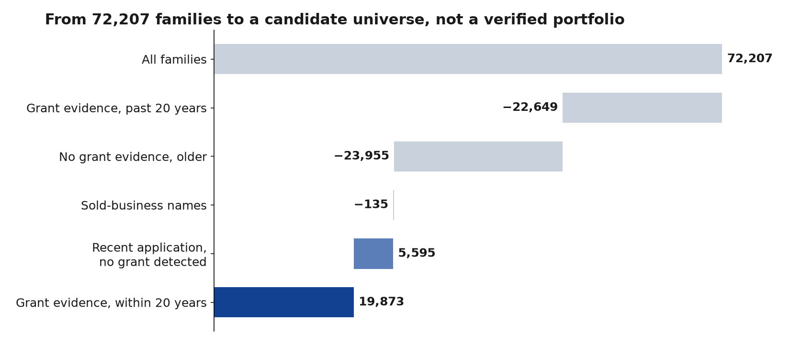

# Candidate portfolio universe

These counts show families where a Nokia-lineage name appears as applicant. **They aren't Nokia's current portfolio.** Filed within the last 20 years doesn't make a family an active Nokia asset.

## What each data category establishes

| Data category | What it establishes | Count so far | Source |
|---|---|---:|---|
| **Historical applicant** | A company or historical entity appears as applicant | 72,207 families | [Working table](../../sql/06_create_portfolio_30y.sql) |
| **Family with grant evidence** | At least one associated publication has evidence of a grant | 19,873 families filed within 20 years | [Status query](../../sql/09_family_status.sql) |
| **Recent application with no grant detected** | A recent application has no detected grant; this isn't proof that it is pending | 5,595 families | Same query, using a date rule |
| **Verified active national right** | Current legal status confirmed in an authoritative register | 0 | Needs USPTO renewal records and other registers |
| **Verified current owner** | Current ownership supported by assignment or register evidence | 0 | Needs USPTO assignment records and other registers |

The last two are the ones a cost or investment decision needs, and neither exists yet.

## How the 72,207 families sort

| Status | Families | Share | Use |
|---|---:|---:|---|
| **Grant evidence, filed within 20 years** | **19,873** | 27.5% | Candidate universe, before ownership and status checks |
| **Recent application with no grant detected** | **5,595** | 7.7% | Tracked separately; not register-verified pending status |
| Grant evidence, filed over 20 years ago | 22,649 | 31.4% | History only |
| No grant evidence, older filing | 23,955 | 33.2% | History only |
| Names from sold businesses only | 135 | 0.2% | Excluded |
| **Total** | **72,207** | | |

The tables are `nokia_analytics.portfolio_30y` and `nokia_analytics.family_status`. The query processed about 15 MB. Some column names and [saved statuses](../../data/processed/family_status.csv) keep the older wording I used when I ran it, such as "core".

## How the rules work

- **Grant evidence:** not an international filing or a design, with a grant date or a kind code starting with B, C or E.
- **Within 20 years:** a granted document filed on or after 1 November 2006.
- **Recent application with no grant detected:** no grant evidence, and filed since 1 January 2021. Absence of a detected grant isn't proof of pending status.
- **Sold businesses:** every applicant name matches cables, optronics, TCL or mobile, or submarine networks.

## Against Nokia's reported figures

[Nokia reports](../03-market-and-patent-analysis/twenty-years.md#portfolio-size-has-two-reported-levels) around 20,000 families for FY2017–FY2023 and 26,000+ for FY2025. My 19,873 and 5,595 total 25,468. **That closeness isn't evidence that the counts match**, as the errors below push in both directions, Nokia's counting rules aren't published, and my count includes patents held by others.

## Current-owner evidence so far

Of the 179 unique Nokia-lineage patents in my [validation sample](validation.md), 42 (23.5%) show a current assignee on Google Patents outside the Nokia lineage, against 2 of 242 for the other four companies. [Source](../../data/validation/results_current_assignee.csv).

| Company | Unique patents sampled | Other current assignee | Share | Largest |
|---|---:|---:|---:|---|
| Nokia, including Alcatel, Lucent and Infinera names | 179 | 42 | 23.5% | WSOU Investments 23, RPX 15 |
| Ciena | 78 | 1 | 1.3% | Kapik 1 |
| Cisco, including Acacia and Luxtera | 84 | 0 | 0% | |
| Arista | 40 | 0 | 0% | |
| Huawei | 40 | 1 | 2.5% | IP Bridge 1 |

Recorded assignments confirm transfers on pages I opened, such as [US8432894B2](https://patents.google.com/patent/US8432894B2/en) to WSOU and [US9825759B2](https://patents.google.com/patent/US9825759B2/en) to Provenance and then RPX. Google Patents isn't a register, so this isn't verified ownership. The sample covers three technologies and US patents only, so 23.5% can't be applied to the whole universe. This is logged as [Q22](../appendices/questions.md#q22-how-much-of-the-portfolio-i-attribute-to-nokia-does-it-still-own).

## Where the counts could be wrong

| Issue | Effect on 19,873 |
|---|---|
| Patents that lapsed because fees weren't paid | Too high |
| Patents transferred to others, as filing names remain | Too high |
| Grants missed outside the US, as [many Japanese records have no applicant name](../03-market-and-patent-analysis/twenty-years.md#japan-needed-fixing) | Too low |
| Applications filed before 2021 with no grant detected | Outside the recent-application category; status unknown |
| Grant dates that look wrong for some offices | Could go either way |

## Grant evidence by office

| Office | Families with grant evidence, filed within 20 years | Share of 19,873 |
|---|---:|---:|
| United States | 15,468 | 78% |
| European Patent Office | 8,696 | 44% |
| China | 2,337 | 12% |

[Full list](../../data/processed/in_term_by_office.csv). Families can appear in several offices. China and others are probably undercounted because of missing grant data. No Japanese grants are detected at all.

In Europe, renewals move to national offices after grant, or to a Unitary Patent, so live status there takes more work than in the US, where one office records all renewals.

## Next checks

1. Estimate the share transferred with a random US sample, then check it against USPTO assignment records.
2. Add USPTO renewal records to identify lapsed US patents.
3. Spot-check [a random sample](../../data/validation/spot_check_sample.csv) against official registers.
4. Find European legal status through Espacenet or a PATSTAT trial.
