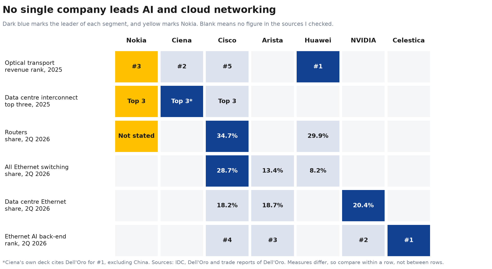
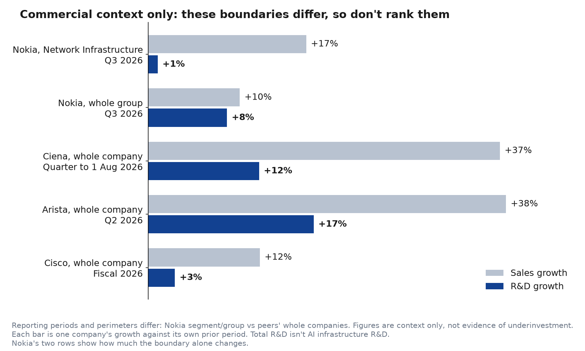

# Market context and peer selection

No single company leads AI and cloud networking. The leader changes by segment, and Nokia's strongest public positions are in optical. This page covers market performance, which is separate from patent performance. The patent comparison is in the [patent landscape](patent-landscape.md).

## Peer selection

Nokia is the reference company, and every company below is compared across [all three categories](../01-research-design/scope.md#technology), not only its main one.

| Company | Main benchmarking role | Research emphasis |
|---|---|---|
| **Ciena** | Optical infrastructure | Coherent optics, data centre interconnect, optical transport |
| **Cisco** | IP networking | Routing, forwarding, network architecture |
| **Arista Networks** | Data-centre networking | Ethernet switching, switching fabrics, congestion |
| **Huawei** | Supplementary global reference | Largest in optical transport and second in routers, with different market exposure |

NVIDIA and Celestica lead AI networking segments, so they appear in the market figures. They aren't patent comparators, because their portfolios differ from Nokia's.

## Segment figures behind the map

| Segment | Figures | Source |
|---|---|---|
| Optical transport, 2025 | Huawei, Ciena, Nokia, ZTE, Cisco, in that order | [SDxCentral, reporting Dell'Oro](https://www.sdxcentral.com/news/huawei-ciena-and-nokia-lead-16b-optical-transport-rebound-as-dci-surges/) |
| Data centre interconnect, 2025 | Ciena, Nokia and Cisco in the top three | [SDxCentral, reporting Dell'Oro](https://www.sdxcentral.com/news/huawei-ciena-and-nokia-lead-16b-optical-transport-rebound-as-dci-surges/) |
| Ciena's #1 in interconnect | Its own claim, excluding China | [Ciena investor presentation](https://www.sec.gov/Archives/edgar/data/0000936395/000162828026040614/ex9922026q2earningsprese.htm) |
| Routers, 2Q 2026 | Cisco 34.7%, Huawei 29.9% | [IDC](https://www.idc.com/resource-center/blog/ethernet-switch-market-surges-43-4-to-18-9b-in-2q26-as-ai-infrastructure-demand-drives-record-datacenter-spending/) |
| All Ethernet switching, 2Q 2026 | Cisco 28.7%, Arista 13.4%, Huawei 8.2% | [IDC](https://www.idc.com/resource-center/blog/ethernet-switch-market-surges-43-4-to-18-9b-in-2q26-as-ai-infrastructure-demand-drives-record-datacenter-spending/) |
| Data centre Ethernet, 2Q 2026 | NVIDIA 20.4%, Arista 18.7%, Cisco 18.2% | [IDC](https://www.idc.com/resource-center/blog/ethernet-switch-market-surges-43-4-to-18-9b-in-2q26-as-ai-infrastructure-demand-drives-record-datacenter-spending/) |
| Ethernet AI back-end, 2Q 2026 | Celestica, NVIDIA, Arista, Cisco, in that order | [Dell'Oro](https://www.delloro.com/news/ai-back-end-networks-switch-sales-surpass-front-end-networks-for-the-first-time-in-2q2026/) |

## Commercial context

**These figures aren't a ranking of AI infrastructure R&D.** Nokia's segment, Nokia's group and the other companies' totals describe different organisational boundaries, periods and accounting bases. Each row only compares a company with its own prior period.

| Company | Boundary and period | R&D as % of sales | Year earlier | R&D growth | Sales growth | Source |
|---|---|---:|---:|---:|---:|---|
| **Nokia** | Network Infrastructure segment, comparable R&D, Q3 2026 | 18.4% | 21.2% | +1% | +17% | [Nokia Q3 report](https://www.sec.gov/Archives/edgar/data/924613/000110465926117972/tm2628115d1_6k.htm) |
| **Nokia** | Whole group, reported R&D, Q3 2026 | 24.3% | 24.6% | +8% | +10% | [Nokia Q3 report](https://www.sec.gov/Archives/edgar/data/924613/000110465926117972/tm2628115d1_6k.htm) |
| **Ciena** | Whole company, quarter to 1 August 2026 | 14.2% | 17.4% | +12% | +37% | [Ciena results](https://www.sec.gov/Archives/edgar/data/936395/000162828026060245/ex9912026q3earningspressre.htm) |
| **Arista** | Whole company, Q2 2026 | 11.5% | 13.4% | +17% | +38% | [Arista 10-Q](https://www.sec.gov/Archives/edgar/data/1596532/000159653226000175/) |
| **Cisco** | Whole company, fiscal 2026 | 15.1% | 16.4% | +3% | +12% | [Cisco results](https://newsroom.cisco.com/c/r/newsroom/en/us/a/y2026/m08/cisco-reports-fourth-quarter-earnings.html) |

Each company defines these AI or cloud figures in its own way, so they can't be compared directly either:

| Company | AI or cloud measure, as the company reports it | As % of its sales | Source |
|---|---|---:|---|
| **Ciena** | Cloud provider revenue | 53% | [Ciena presentation](https://s25.q4cdn.com/550667411/files/content_files/Ex-99-2-2026-Q3-Earnings-Presentation_FINAL-1.pdf) |
| **Nokia** | Sales to AI and cloud customers | 12% | [Nokia Q3 report](https://www.sec.gov/Archives/edgar/data/924613/000110465926117972/tm2628115d1_6k.htm) |
| **Cisco** | AI infrastructure revenue, fiscal 2026 | 6% | [Cisco results](https://newsroom.cisco.com/c/r/newsroom/en/us/a/y2026/m08/cisco-reports-fourth-quarter-earnings.html) |

**What it does show, per company:**

- **Nokia's boundary matters:** R&D rose 1% in Network Infrastructure and 8% across the group, in the same quarter.
- **Each company's R&D share of its own sales fell:** demand grew faster than R&D, so a falling share doesn't by itself mean underinvestment.

**What to test next:** whether Nokia's optical, routing and switching filings are growing while its segment R&D is flat, as part of [commercial alignment](commercial-alignment.md).

## Check of the draft competitor summary

I checked a software-assisted draft competitor summary against its sources. [All 18 claims are logged](../../data/validation/competitor_claims_check.csv).

| Result | Claims | Notes |
|---|---:|---|
| Confirmed in a primary or original source | 14 | Includes all the IDC share figures I checked |
| Trade report of Dell'Oro | 2 | Full Dell'Oro reports are paid, so these rely on secondary coverage |
| Company's own claim | 1 | Ciena's #1 in data centre interconnect, which excludes China |
| Wrong label | 1 | $2.5B and 37.6% are Arista's switch revenue, not its total revenue |

**Other problems with the draft:**

- **It left out the AI back-end leader.** Dell'Oro puts Celestica first and NVIDIA second in Ethernet AI back-end switching.
- **Periods don't line up.** Company fiscal periods and market data cover different dates.
- **The lessons were opinion.** Its statements on what Nokia should learn from each competitor are hypotheses to test, not findings.
- **"Nokia is not necessarily losing" isn't established.** Growth rates alone can't show that.

## What this can't tell me

Market share shows who sells the most. It doesn't show who holds the strongest patents.
