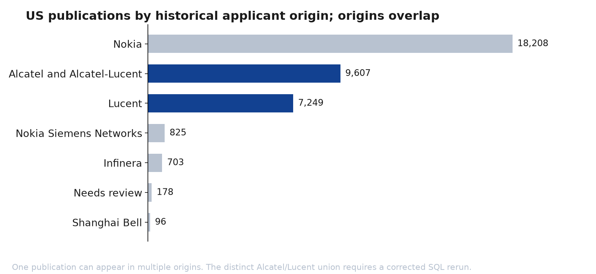
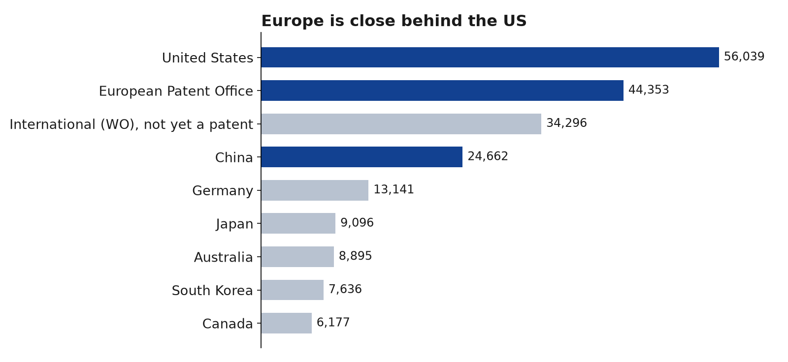

# Patent landscape

**Status: first estimates, low confidence, pre-pivot.** This page answers the pre-pivot position and comparison questions as far as the evidence goes. It uses claim-based estimates because [code counts failed the precision test](../02-methodology/validation.md#precision-result).

## Estimated US families by company

These are simple families with a granted US member filed since November 2006, where the company's name appears as applicant at filing. Estimate = families in the pool × the share of that company's sample whose claims earned the class. Brackets show the 95% range on that share alone. [Source](../../data/validation/results_precision.csv).

| Company | Optical | IP routing | Switching (H04L 49) |
|---|---|---|---|
| **Nokia lineage** | 768 (641–840) | 233 (151–329) | 70 (46–97) |
| Ciena | 263 (169–342) | 90 (47–146) | 40 (24–57) |
| Cisco, with Acacia and Luxtera | 233 (155–294) | 792 (410–1,284) | 220 (120–337) |
| Arista | 9 (5–12) | 143 (74–198) | 33 (14–57) |
| Huawei | 746 (423–950) | 714 (300–1,226) | 175 (73–300) |

The ranges are wide, and they overlap for many pairs. Nokia against Cisco in optical and in routing doesn't overlap, and neither does Nokia against Cisco in switching.

## The same estimate, keeping only patents without another current assignee

Nokia's figures drop more than anyone's, because [its patents show transfers and the others mostly don't](../02-methodology/candidate-portfolio-universe.md#current-owner-evidence-so-far). Current assignee comes from Google Patents, not a register. These are mid-points only. [Source](../../data/validation/results_estimates_current_assignee.csv).

| Company | Optical | IP routing | Switching (H04L 49) |
|---|---:|---:|---:|
| **Nokia lineage** | 633 | 202 | 26 |
| Ciena | 263 | 90 | 40 |
| Cisco, with Acacia and Luxtera | 233 | 792 | 220 |
| Arista | 9 | 143 | 33 |
| Huawei | 746 | 714 | 175 |

## What this suggests

| Category | Reading | What to do next |
|---|---|---|
| **Optical** | Nokia's lineage looks about level with Huawei, and well above Ciena and Cisco | Test with verified ownership and recall before calling it a strength |
| **IP routing** | Cisco and Huawei are well above Nokia's lineage. This supports H2, so far | Measure 2020–2024 filings by claim, as H2 asks |
| **Switching** | Cisco and Huawei lead. Nokia's lineage falls from 70 to 26 once other assignees are removed, on a sample of 40 | Check first, because this could be the largest exposure |

These are priorities to investigate, not final results. Only 1 patent in the test is explicitly about AI (US-12244465-B2), and 17 mention a data centre, cloud or HPC setting, so the counts describe general networking position rather than AI infrastructure.

## Hypotheses

| Hypothesis | Status |
|---|---|
| **H1:** Infinera strengthened Nokia's optical position | Not tested |
| **H2:** Nokia trails the leaders in routing and switching | First estimates point this way, for all years rather than 2020–2024 |
| **H3:** Cover is ageing without enough replacement | Not tested. [Precision falls in newer patents](../02-methodology/validation.md#precision-by-priority-period), so it needs claim-based estimates by period |
| **H4:** Cover in main markets has gaps | Not tested |

## Where Nokia's patents came from

This is portfolio lineage, not current ownership.

The saved recount verifies 36,630 distinct US publications filed since 1996 and 37,710 owner-publication listings. Origin counts overlap and sum to 36,866, so they cannot establish a distinct Alcatel/Lucent share. That share awaits a corrected publication-level SQL rerun; BigQuery cannot be rerun in this environment. [Source](../../data/processed/us_30y_recount.csv). Any cost or renewal analysis needs to report Alcatel and Lucent lineage separately, because Lucent spun off Avaya and Agere and those patents may have left with them.

## Where applications were filed

[Source](../../data/raw/filings_by_country.csv). These are applications at each office, not granted or live rights. WO filings aren't patents yet.
