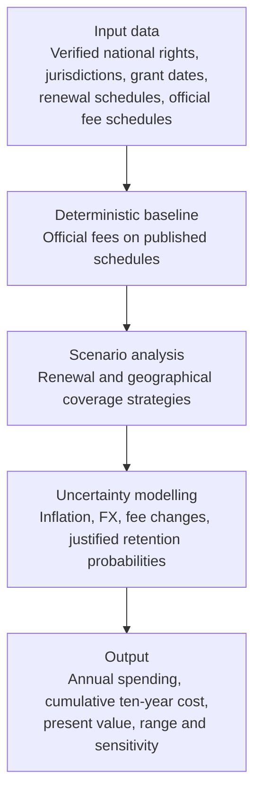

# Ten-year maintenance cost model

**Status: designed, not built.** This is the principal financial model and feeds RQ5. It's an indicative statutory maintenance-cost model, **not an estimate of Nokia's actual total patent expenditure.**

## Q9: the research question

What would it cost to maintain a defined portfolio of patent rights over ten years, expressed as a range under alternative maintenance and geographical coverage strategies?

**Purpose:** understand the financial implications of alternative maintenance decisions, and identify which assumptions most influence projected spending.

## Model architecture

## Scenarios

| Scenario | Description | Rule to set |
|---|---|---|
| **A: Maintain** | Maintain all verified sampled rights | None |
| **B: Selective maintenance** | Prioritise selected geographical markets | Which offices, tied to [H4](../01-research-design/research-questions.md#hypotheses) |
| **C: Optimisation** | Apply more restrictive retention assumptions | Which rights lapse at each renewal point, using observed renewal rates |

## Modelling rules

| Rule | Why |
|---|---|
| Fees are calculated per individual national right, not per family | Fees are paid per right |
| Official fee schedules are deterministic inputs | They're published |
| Future fee changes and currency movements are uncertain variables | They aren't known |
| Use empirical renewal data if available | The [placeholders in the register](assumptions-and-scenarios.md#behaviour-what-happens-next) aren't findings |
| Use [Monte Carlo](../glossary.md#statistics-in-plain-language) only where probability distributions can be justified | A probability curve on invented distributions would look precise without being so. The posting asks for ranges with a probability curve, so I'll build one for inputs with data behind them, such as renewal rates, and use plain scenarios for the rest |
| Exclude internal Nokia staff costs, professional fees and confidential licensing spending from the baseline | They aren't public, and invented figures would blur what's official |

## Inputs

| Input | Status |
|---|---|
| US large-entity fees of $2,150, $4,040 and $8,280 | [Official](../appendices/sources.md#patent-rules-and-data-sources), recheck before use |
| Sampled verified national rights | Not available. Needs a sample of families expanded to rights, with register checks |
| US renewal records | [USPTO account access required](https://data.uspto.gov/bulkdata/datasets/ptmnfee2); researcher must obtain and review the records. Not downloaded yet |
| EPO fees | [Official rules found](https://www.epo.org/en/legal/epc/2020/EPC_rfees_20260401_en_20260326.pdf), figures not extracted |
| National fees after European grant, and Chinese and Japanese fees | Not collected |
| Fee growth and exchange rates | Not set |
| Discount rates | 5%, 10% and 15%, because Nokia's rate isn't public |

## Build order

1. Define the sampled rights, and verify status and owner in registers.
2. Build the US baseline with official fees.
3. Add renewal rates from USPTO records.
4. Add the European Patent Office, China and Japan, or state them as a gap if there's no time.
5. Run scenarios A, B and C, then sensitivity.

## Supporting model

The [US renewal break-even](us-renewal-break-even.md) stays as a separate supporting calculation for a single patent's keep-or-drop decision.
