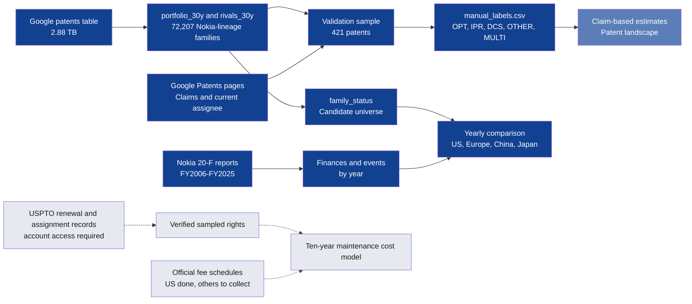
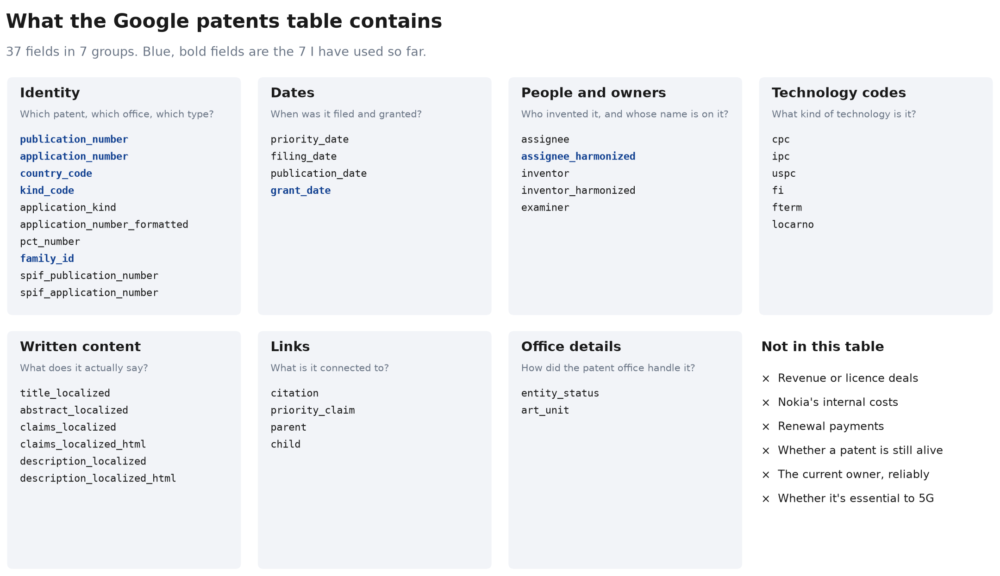

# Data map

Which data feeds which work, and what's missing. Progress is tracked in the [evidence tracker](evidence-gaps.md).

## How the data fits together

Dark blue is built, mid blue is first estimates only, and grey is still to do.

## Repository data folders

| Folder | Contents |
|---|---|
| [`data/raw/`](../../data/raw) | Query results and source files as received. Annual reports stay local because of their size |
| [`data/interim/`](../../data/interim) | Cleaned applicant name mappings |
| [`data/processed/`](../../data/processed) | Tables behind the documents |
| [`data/validation/`](../../data/validation) | Samples, labels, checks and scores |
| [`data/source_manifest.csv`](../../data/source_manifest.csv) | Which query or source produced each snapshot, with a fingerprint |

Older file names use "owner" for the applicant name on a record, such as [`owner_counts.csv`](../../data/raw/owner_counts.csv). The saved SQL keeps the words I ran it with.

## What I have

| Data | Covers | Where it is | Reliability |
|---|---|---|---|
| Nokia-lineage patent table | Filings since November 1996, in 64 offices | `nokia_analytics.portfolio_30y`, [build query](../../sql/06_create_portfolio_30y.sql) | [Trust notes](../02-methodology/data-quality-and-lineage.md) |
| Competitor patent table | Ciena, Cisco with Acacia and Luxtera, Arista, Huawei | `nokia_analytics.rivals_30y`, [build query](../../sql/15_rivals_30y.sql) | Same limits |
| Family status | Every Nokia-lineage family sorted by status | `nokia_analytics.family_status`, [results](../../data/processed/family_status.csv) | Lapsed and transferred patents aren't removed |
| Validation labels | 421 patents | [`manual_labels.csv`](../../data/validation/manual_labels.csv) | [First pass, pending review](../02-methodology/validation.md) |
| Filings by year and office | US, Europe, China and Japan, 1996–2026 | [`office_filings_by_year.csv`](../../data/processed/office_filings_by_year.csv) | Recent years are incomplete |
| Yearly finances | 20 fiscal years | [`nokia_financials_by_year.csv`](../../data/processed/nokia_financials_by_year.csv) | Official, but comparability breaks in 2013 and 2016 |
| Commercial context | Latest period per company | [`commercial_context.csv`](../../data/processed/commercial_context.csv) | Official, with different boundaries |
| Dated events | 16 major events | [`nokia_events.csv`](../../data/processed/nokia_events.csv) | Selected, not exhaustive |
| Annual reports | FY2006–FY2025 | On my computer, listed in [the manifest](../../data/raw/annual_reports_manifest.csv) | Official |

BigQuery tables expire after 60 days in the sandbox. The saved queries can rebuild them, and local snapshots keep the results.

## What's missing

| Data | Why it matters | Status |
|---|---|---|
| USPTO renewal records | Real keep-or-drop behaviour, and live US rights | [USPTO account access required](https://data.uspto.gov/bulkdata/datasets/ptmnfee2); not downloaded |
| USPTO assignment records | Verified US owners | Same portal |
| European, Chinese and Japanese fees | Costs beyond the US | Public, not collected |
| Legal status outside the US | Live rights in Europe, China and Japan | Harder to get, may need a PATSTAT trial |
| Nokia's patent budget, cost per patent and licence terms | The real figures | Not public, so these stay as labelled assumptions |

## What's in the Google table

I've analysed 8 of its 37 fields. My working table also holds inventors, technology codes, titles, abstracts and citations for later. The groupings are my own, based on the field names.
