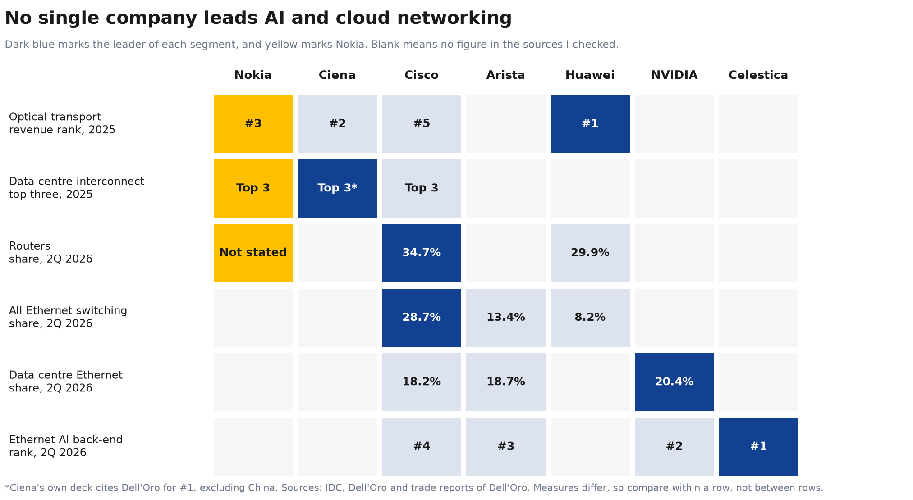
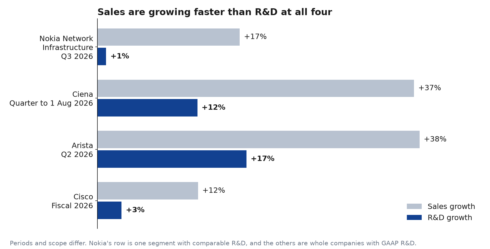

# AI and cloud networking: who leads?

No single company leads. The leader changes by segment, and Nokia's strongest public positions are in optical.

## Segment figures behind the map

| Segment | Figures | Source |
|---|---|---|
| Optical transport, 2025 | Huawei, Ciena, Nokia, ZTE, Cisco, in that order | [SDxCentral, reporting Dell'Oro](https://www.sdxcentral.com/news/huawei-ciena-and-nokia-lead-16b-optical-transport-rebound-as-dci-surges/) |
| Data centre interconnect, 2025 | Ciena, Nokia and Cisco in the top three | [SDxCentral, reporting Dell'Oro](https://www.sdxcentral.com/news/huawei-ciena-and-nokia-lead-16b-optical-transport-rebound-as-dci-surges/) |
| Ciena's #1 in interconnect | Its own claim, excluding China | [Ciena investor presentation](https://www.sec.gov/Archives/edgar/data/0000936395/000162828026040614/ex9922026q2earningsprese.htm) |
| Routers, 2Q 2026 | Cisco 34.7%, Huawei 29.9% | [IDC](https://www.idc.com/resource-center/blog/ethernet-switch-market-surges-43-4-to-18-9b-in-2q26-as-ai-infrastructure-demand-drives-record-datacenter-spending/) |
| All Ethernet switching, 2Q 2026 | Cisco 28.7%, Arista 13.4%, Huawei 8.2% | [IDC](https://www.idc.com/resource-center/blog/ethernet-switch-market-surges-43-4-to-18-9b-in-2q26-as-ai-infrastructure-demand-drives-record-datacenter-spending/) |
| Data centre Ethernet, 2Q 2026 | NVIDIA 20.4%, Arista 18.7%, Cisco 18.2% | [IDC](https://www.idc.com/resource-center/blog/ethernet-switch-market-surges-43-4-to-18-9b-in-2q26-as-ai-infrastructure-demand-drives-record-datacenter-spending/) |
| Ethernet AI back-end, 2Q 2026 | Celestica, NVIDIA, Arista, Cisco, in that order | [Dell'Oro](https://www.delloro.com/news/ai-back-end-networks-switch-sales-surpass-front-end-networks-for-the-first-time-in-2q2026/) |

## Investment position

**Question this answers:** how much of each company's business depends on AI and cloud, and is it putting more into R&D as sales grow?

| Company | Scope and period | R&D as % of sales | Year earlier | R&D growth | Sales growth | Source |
|---|---|---:|---:|---:|---:|---|
| **Nokia** | Network Infrastructure, Q3 2026 | 18.4% | 21.2% | +1% | +17% | [Nokia Q3 report](https://www.sec.gov/Archives/edgar/data/924613/000110465926117972/tm2628115d1_6k.htm) |
| **Nokia** | Whole group, Q3 2026 | 24.3% | 24.6% | +8% | +10% | [Nokia Q3 report](https://www.sec.gov/Archives/edgar/data/924613/000110465926117972/tm2628115d1_6k.htm) |
| **Ciena** | Whole company, quarter to 1 August 2026 | 14.2% | 17.4% | +12% | +37% | [Ciena results](https://www.sec.gov/Archives/edgar/data/936395/000162828026060245/ex9912026q3earningspressre.htm) |
| **Arista** | Whole company, Q2 2026 | 11.5% | 13.4% | +17% | +38% | [Arista 10-Q](https://www.sec.gov/Archives/edgar/data/1596532/000159653226000175/) |
| **Cisco** | Whole company, fiscal 2026 | 15.1% | 16.4% | +3% | +12% | [Cisco results](https://newsroom.cisco.com/c/r/newsroom/en/us/a/y2026/m08/cisco-reports-fourth-quarter-earnings.html) |

| Company | AI or cloud measure | As % of sales | Source |
|---|---|---:|---|
| **Ciena** | Cloud provider revenue | 53% | [Ciena presentation](https://s25.q4cdn.com/550667411/files/content_files/Ex-99-2-2026-Q3-Earnings-Presentation_FINAL-1.pdf) |
| **Nokia** | Sales to AI and cloud customers | 12% | [Nokia Q3 report](https://www.sec.gov/Archives/edgar/data/924613/000110465926117972/tm2628115d1_6k.htm) |
| **Cisco** | AI infrastructure revenue, fiscal 2026 | 6% | [Cisco results](https://newsroom.cisco.com/c/r/newsroom/en/us/a/y2026/m08/cisco-reports-fourth-quarter-earnings.html) |

**What it shows:**

- **Nokia's network R&D barely moved:** it rose 1% while segment sales rose 17%. Of the four, it's the lowest R&D growth, though Cisco's +3% covers a full year.
- **Everyone's R&D share fell:** demand is growing faster than R&D at all four, so a falling share doesn't by itself mean underinvestment.
- **Nokia is much less exposed to AI and cloud than Ciena:** 12% of sales against 53%. That could mean more room to grow, or a weaker position, and patents can help test which.

**What it can't show:** these aren't fully like for like. Nokia's segment figure uses comparable R&D and excludes group-level items, the others are whole companies, the periods differ, and each company defines its AI or cloud figure in its own way. Total R&D also isn't R&D on AI and cloud.

**What to test next:** whether Nokia's optical and IP patent filings are growing as fast as its rivals' while its segment R&D is flat.

## Sanity check of the draft analysis

I checked a draft competitor summary from another AI tool against its sources. [All 18 claims are logged](../data/processed/competitor_claims_check.csv).

| Result | Claims | Notes |
|---|---:|---|
| Confirmed in a primary or original source | 14 | Includes all the IDC share figures I checked |
| Trade report of Dell'Oro | 2 | Full Dell'Oro reports are paid, so these rely on secondary coverage |
| Company's own claim | 1 | Ciena's #1 in data centre interconnect, which excludes China |
| Wrong label | 1 | $2.5B and 37.6% are Arista's switch revenue, not its total revenue |

**Other problems with the draft:**

- **It left out the AI back-end leader.** Dell'Oro puts Celestica first and NVIDIA second in Ethernet AI back-end switching.
- **Periods don't line up.** Company fiscal periods and market data cover different dates.
- **The lessons were opinion.** Its statements on what Nokia should learn from each rival are hypotheses to test, not findings.
- **"Nokia is not necessarily losing" isn't established.** Growth rates alone can't show that, and patents haven't been compared yet.

## Comparison set

| Role | Companies | Why |
|---|---|---|
| **Core** | Ciena, Cisco, Arista | Optical, overall networking and data centre focus |
| **Global benchmark** | Huawei | Largest in optical transport, second in routers, with different market exposure |
| **Adjacent** | NVIDIA, Celestica | Lead AI networking segments, but differ from Nokia's portfolio |

## What this can't tell me

Market share shows who sells the most. It doesn't show who holds the strongest patents, so the next step is to test that using the [research design](research-design.md).
