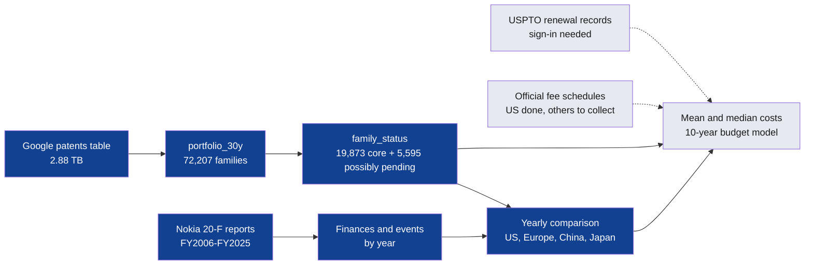

# Data map

Where the project stands, which data feeds which work and what's missing. The question being answered is [how to allocate a limited patent budget](strategy.md).

## How the data fits together

Blue is built, and grey is still to do.

## What I have

| Data | Covers | Where it is | Reliability |
|---|---|---|---|
| Working patent table | Filings since November 1996, in 64 offices | `nokia_analytics.portfolio_30y`, [build query](../sql/06_create_portfolio_30y.sql) | [See trust notes](data-trust.md) |
| Family status | Every family sorted by status | `nokia_analytics.family_status`, [results](../data/processed/family_status.csv) | Lapsed and sold patents aren't removed |
| Filings by year and office | US, Europe, China and Japan, 1996–2026 | [`office_filings_by_year.csv`](../data/processed/office_filings_by_year.csv) | Recent years are incomplete |
| Yearly finances | 20 fiscal years | [`nokia_financials_by_year.csv`](../data/processed/nokia_financials_by_year.csv) | Official, but comparability breaks in 2013 and 2016 |
| Dated events | 16 major events | [`nokia_events.csv`](../data/processed/nokia_events.csv) | Selected, not exhaustive |
| Annual reports | FY2006–FY2025 | On my computer, listed in [the manifest](../data/raw/annual_reports_manifest.csv) | Official |

BigQuery tables expire after 60 days in the sandbox, and the saved queries can rebuild them.

## What's missing

| Data | Why it matters | Status |
|---|---|---|
| USPTO renewal records | Real keep-or-drop behaviour, and mean and median renewal costs | [Needs a USPTO.gov account](https://data.uspto.gov/bulkdata/datasets/ptmnfee2) |
| USPTO assignment records | Finds US patents that were sold | Same portal |
| European, Chinese and Japanese fees | Costs beyond the US | Public, not collected |
| Legal status outside the US | Live patents in Europe, China and Japan | Harder to get, may need a PATSTAT trial |
| Nokia's patent budget, cost per patent and licence terms | The real figures | Not public, so these stay as labelled assumptions |

## What's in the Google table

I've analysed 8 of its 37 fields. My working table also holds inventors, technology codes, titles, abstracts and citations for later. The groupings are my own, based on the field names.

## The project at a glance

| Work | Status |
|---|---|
| [Workable portfolio](portfolio-filter.md) | Built, with lapsed and sold patents still to remove |
| [Twenty years of patents and money](twenty-years.md) | Built |
| Register spot-check | Not started |
| Mean and median patent costs | [Illustrative only](strategy.md#mean-and-median-patent-costs), until renewal records are available |
| 10-year cost forecast | Not started |
| Scenarios, sensitivity and probability curve | Not started |
| Capacity plan and decision brief | Not started |

## Open questions

| # | Question | What it needs |
|---|---|---|
| Q20 | Why did reported families fall from 26,000+ to about 20,000, then return to 26,000+? | Closer reading, then USPTO records |
| Q7 | How many unique patents are alive? | Renewal data |
| Q8 | Which patents do owners stop paying for? | USPTO renewal records |
| Q9 | What would keeping them cost over 10 years? | Fees and a model |
| Q13 | Did Lucent's patents stay in the family? | Patent assignment records |

The full notes, including answered questions, are in the [question log](questions.md).
