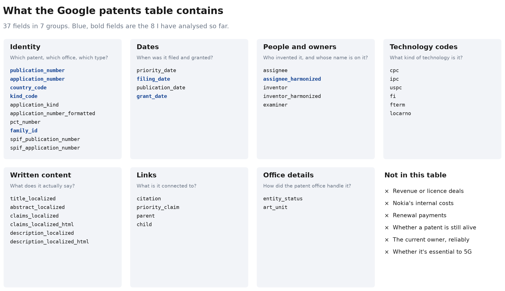

# Data map

Where I am, what the data contains and which questions it can answer. My focus is patents filed in the last 30 years. The full notes for each question are in the [question log](questions.md).

## The big picture

Blue steps have been started, and grey steps haven't. The owner step is still being corrected because of the older patents I missed.

## What each group can tell me

| Group | What it tells me | Used so far | Questions it could answer |
|---|---|---|---|
| **Identity** | The patent, office, type and family | Yes | Where was it filed? How many inventions are there, not just filings? |
| **Dates** | Filing and grant timing | Partly | When could protection run out? Is new invention replacing it? |
| **People and owners** | Owner names and inventors | Owners analysed, inventors in my table | Whose name is on it? Who are the most prolific inventors? |
| **Technology codes** | Classification of the invention | In my table | Which technologies could lose protection soonest? |
| **Written content** | Titles, abstracts, claims and full text | Titles and abstracts in my table | What are the patents about in plain words? |
| **Links** | Citations and related filings | Citations in my table | Which patents do others build on? |
| **Office details** | Examining unit and applicant size status | Not yet | I haven't looked at these yet |

I've only analysed 8 of the 37 fields so far, though my working table now holds more of them. The groupings and descriptions are my own, based on the field names, so some may change once I look more closely.

## What the sources cover

| Information | Google patents table | PATSTAT Global | USPTO fee records | ETSI declarations |
|---|---|---|---|---|
| Owners, dates, offices | Yes | Yes | No | No |
| Technology codes, citations | Yes | Yes | No | No |
| Renewals | Not in main table | Yes (EP detail) | Yes (US) | No |
| Lapses | Not in main table | Yes | Yes (US) | No |
| Essential to a standard | No | No | No | Yes |
| Revenue | No | No | No | No |
| Cost to me | Free up to 1 TB a month | Paid | Not checked | Not checked |
| Status | **In use** | Read the catalog | Not opened | Not opened |

I've only used the Google table so far. The USPTO and ETSI columns reflect what I expect to find, and I haven't opened those sources yet.

## My questions at a glance

The business questions I'm working towards are in the [analysis strategy](strategy.md).

### Answered

| # | Question | Short answer |
|---|---|---|
| Q1 | What does a portfolio team do? | Decides which patents are worth keeping (my inference) |
| Q2 | Where can I get the data? | Google for now, PATSTAT as the upgrade |
| Q3 | What is a data catalog? | The manual for a database |
| Q4 | How do I get into the Google data? | SQL in the BigQuery sandbox |
| Q5 | Under which names do the patents appear? | Many, with a few names holding most listings |
| Q6 | What do those names mean? | Company history, typos and false matches |
| Q11 | Where did the portfolio come from? | Partly Alcatel-Lucent, with shares being corrected in Q15 |
| Q12 | Where does Nokia file? | US first, Europe close behind, China next after the international filings |
| Q14 | Did I miss older patents? | Yes, 8,808 of them |
| Q15 | What does the last 30 years look like? | 72,207 inventions across 64 offices |

### Open

| # | Question | What it needs |
|---|---|---|
| Q7 | How many unique patents are alive? | Cleaned names and renewal data |
| Q8 | Which patents do owners stop paying for? | USPTO fee records |
| Q9 | What would keeping them cost over 10 years? | Official fees and a model |
| Q10 | Which "Needs review" names did Nokia inherit? | Company histories |
| Q13 | Did Lucent's patents stay in the family? | Patent assignment records |

### Ideas not started

- Does Nokia keep Alcatel's patents as long as its own?
- What happened to the phone patents after the sale to Microsoft?
- How do Nokia's renewal habits compare with Ericsson's?
