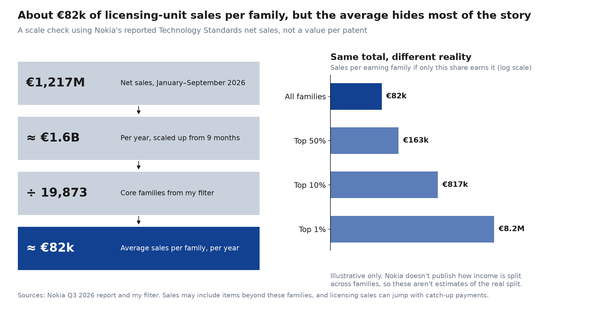

# Can I trust this data?

## Where it comes from

1. **Patent offices** publish the records, such as the USPTO, EPO and CNIPA. These are official documents.
2. **Data providers** collect them. The Google table is supplied by [IFI CLAIMS](https://www.ificlaims.com/news/view/blog-posts/public-patent-data-now.htm), and simple families follow the [EPO's DOCDB family identifier](https://inspire.wipo.int/node/3481).
3. **Google** publishes the result in BigQuery. The table was last modified on 23 September 2026, with filings to August 2026. Google's [example code repository was archived in April 2026](https://github.com/google/patents-public-data), so I check the table's own date rather than relying on that repository.
4. **I filter it** with my own SQL, which is saved in [`sql/`](../sql), so anyone can check it.

## How far to trust each part

| Data | Trust | Why |
|---|---|---|
| Publication numbers, offices, filing dates | High | Official bibliographic records |
| Technology codes | Fairly high | Assigned by examiners or offices, but they can be broad |
| US grants | High | US grant dates add up across my queries |
| Grants outside the US | **Low to medium** | Japan shows 0 grant dates, and Austria 99.8% |
| Owner names | **Medium** | Cleaned names, which may not show later sales or transfers |
| Legal status and current owner | **Not available** | [IFI sells these separately](https://www.ificlaims.com/news/view/blog-posts/public-patent-data-now.htm) |
| Family counts | Medium | [Providers define families differently](https://iamip.com/wiki/patent-family/) |

I didn't find a formal accuracy audit of this dataset.

## How I check it

1. **Compare totals across queries.** That's how I found the 8,808 missing US patents.
2. **Spot-check against official registers.** Compare [a repeatable random sample of 35](../data/processed/spot_check_sample.csv) with [Espacenet](https://worldwide.espacenet.com/) and the USPTO, and record the error rate. The sample has none from Japan, because no Japanese grants were detected. Checks not done yet.
3. **Compare with what Nokia reports.** [New families follow its reported new inventions](twenty-years.md#my-family-counts-follow-nokias-own-numbers), though its counting rules may differ from mine.
4. **State the reliability next to every number.**

## Where to find money data

| Source | What it gives | Status |
|---|---|---|
| [Nokia's 20 annual reports, FY2006–FY2025](../data/raw/annual_reports_manifest.csv) | R&D, licensing, segments, deals and risks | Official, [key figures extracted](twenty-years.md) |
| [Nokia's Q3 2026 report](https://www.sec.gov/Archives/edgar/data/924613/000110465926117972/tm2628115d1_6k.htm) | Technology Standards net sales of €425M in Q3 and €1,217M for January–September, and R&D expenses of €1,251M in Q3 | Official |
| [USPTO fee schedule](https://www.uspto.gov/learning-and-resources/fees-and-payment/uspto-fee-schedule) | US renewal fees | Official |
| [EPO fee rules](https://www.epo.org/en/legal/epc/2020/EPC_rfees_20260401_en_20260326.pdf) | European fees from 1 April 2026 | Official, figures not extracted yet |
| National patent offices | Renewals after a European grant, by country | Official, not collected yet |
| [OPPO v. Nokia ruling](https://www.chinaiplawupdate.com/2023/12/chongqing-no-1-intermediate-peoples-court-sets-global-frand-rate-for-5g-seps-at-0-707-unit-in-nokia-oppo-case/) | A court's 5G rates of $1.151 and $0.707 per phone, by territory | Disputed by Nokia and later settled confidentially |
| [USPTO assignment data](https://iipla.org/news/uspto-to-upgrade-assignment-search-and-relocate-patent-export-data-to-open-data-portal-in-july-2026) | US patent sales and transfers | Public, location to be confirmed |

Nokia's actual patent budget, its costs per patent and the terms of its deals remain private, so those stay as labelled assumptions.

### A rough sense of scale

Licensing income is usually concentrated in a few programmes and families, so this isn't a value per patent. Using Nokia's 26,000+ families instead gives about €62k, and yearly sales also swing with renewal cycles. The right-hand chart shows how different the same total looks under different splits. Those splits are illustrative, not estimates.
