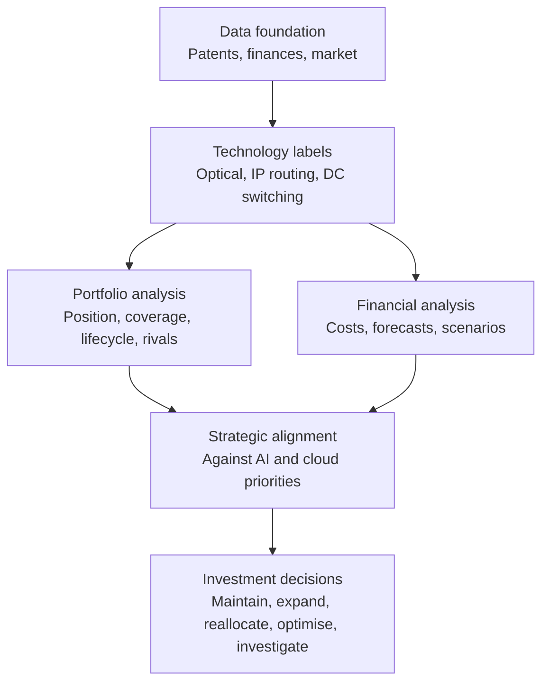

# Research design

## Central research question

> **How should Nokia prioritise its patent portfolio investments to support its AI and cloud infrastructure strategy?**
>
> Where is Nokia's patent portfolio strategically strong or exposed across optical networking, IP routing and data centre switching, how does its position compare with relevant competitors, and what do portfolio costs, technological developments and commercial trends suggest about future investment priorities?

~~How does Nokia's patent portfolio and associated investment position compare with the leading competitors in AI and cloud infrastructure networking, and what strategic and financial lessons can be identified?~~

**Why it changed:** the earlier question was too broad, made comparison the goal and didn't say which decisions the research should inform. The [role](https://www.linkedin.com/jobs/view/4483030441) is about turning patent and financial data into investment decisions.

## How the work fits together

## The five research questions

| # | Question | What I measure | Output | Limit |
|---|---|---|---|---|
| **1** | What does Nokia actually own? | Families by technology, filing trends, grants, coverage, and live rights where available | Patent inventory | Ownership and status are incomplete outside the US |
| **2** | Where does Nokia stand against competitors? | Filing momentum, concentration, granted families, coverage, and age-adjusted citations | Competitor benchmark | Patent position isn't commercial success |
| **3** | Is the portfolio aligned with commercial growth? | Patent trends against [reported AI, cloud and R&D figures](competitors.md#investment-position) | Technology-to-business assessment | Public links between patents and products are limited |
| **4** | What do patent costs suggest about allocation? | Estimated filing, prosecution and renewal costs by office and technology | Cost estimate and scenarios | Can't measure Nokia's actual efficiency |
| **5** | What should Nokia do differently? | Maintain, Concentrate and Optimise scenarios, with costs, risks and sensitivity | Business case and recommendation | Shows priorities to investigate, not final decisions |

## Competitor benchmarks

| Technology | Primary benchmark | Focus |
|---|---|---|
| Optical networking | Ciena | Optical innovation, interconnect and coherent transmission |
| IP routing | Cisco | Routing architecture, protocols and traffic engineering |
| Data centre switching | Arista | Fabrics, Ethernet and congestion management |

All three are screened in every area, and [Huawei stays a global benchmark](competitors.md#comparison-set), as it's the largest optical vendor and second in routers.

## How far this can go

| Level | What it can do | Status |
|---|---|---|
| **1. Public data** | Patent position, technology trends, competitor activity, coverage, commercial indicators, and estimated costs from official fees | This project |
| **2. Internal data** | Actual spending, efficiency, forecasts and real business cases | Needs access to Nokia's systems |

I changed the wording of question 4 from "is Nokia allocating its budget efficiently?" because public data can't answer that.

## What I'm avoiding

| Avoid | Instead |
|---|---|
| Ranking companies by total patents | Compare relevant families by technology |
| Treating every data centre patent as AI-related | Use the [AI and cloud relevance score](classification-codebook.md#extra-fields) |
| Treating citations as value | Use them as one indicator of influence |
| Treating filings as commercial success | Compare with market performance from separate sources |
| Treating portfolio size as efficiency | Analyse costs and outcomes |
| Dividing revenue by patent costs to claim ROI | State what's attributable, and what isn't |
| Firm conclusions from recent records | Allow for publication and legal-status delays |

These three technologies are a selected lens on AI and cloud infrastructure, not everything Nokia does in that market.

Metrics only matter if they can change a decision. The rest of this page sets what counts as an answer, and I fix these rules before seeing the results.

## Earlier priorities

Priority 1 below feeds research questions 1–3. Priorities 2 and 3 are later extensions, and only happen if the main work passes its checks.

| Priority | Decision it informs | Deliverable | Achievable reliability |
|---|---|---|---|
| **1. AI and cloud infrastructure** | Where to direct optical and IP patent and R&D spending | Technology gap map and R&D opportunity analysis | **Medium to high** for patent position, not for commercial return |
| **2. AI-RAN and 6G** | Which capabilities to build, partner on or watch | Strategic technology capability map | **Low to medium**, as the field is young and classification is harder |
| **3. Licensing opportunities** | Which areas and companies deserve a closer commercial look | Public-source opportunity database | **Medium** for patents, **low** for who is already licensed |

**Order:** Priority 1 first, as it has the cleanest data and connects to [Nokia's reported growth](sources.md#nokias-business-structure). Priorities 2 and 3 use the same method if Priority 1 passes its checks.

All three feed research questions 4 and 5: each ends by saying what it would change about where money goes.

## Priority 1: AI and cloud infrastructure

**Question:** does Nokia's patent position in optical and IP networking support its growth, and where are the gaps? These hypotheses feed research questions 1–3.

| Hypothesis | Measure | What would disprove it |
|---|---|---|
| H1: Infinera materially strengthened Nokia's optical position | Optical families and share, with and without Infinera | Infinera adds little in key optical areas, or mostly duplicates Nokia's cover |
| H2: Nokia's IP position trails the leaders in data centre networking | Share of new families in routing and switching, 2020–2024 | Nokia's share is level with or above the leading rivals' |
| H3: Part of Nokia's cover is ageing without enough replacement | Families reaching 20 years by 2036, against new families | New families outnumber expiring ones in each area |
| H4: Cover in the main markets has gaps | Share of families in the US, Europe, China and Japan, against rivals | Coverage matches rivals' in each market |

**Comparison set:** [the benchmarks above](#competitor-benchmarks). Owner names need the same cleaning I used for Nokia, and deals such as Cisco's Acacia must be handled explicitly.

**Output:** a heatmap of technology areas against companies, showing share and growth, then a short list of gaps ranked by size, confidence and link to the business.

## Priority 2: AI-RAN and 6G

**Question:** where does Nokia hold a strong position in AI-native networks and 6G, and where does it depend on others?

| Hypothesis | Measure | What would disprove it |
|---|---|---|
| H5: Nokia has a leading position in RAN automation | Share of families matched to a tested definition | Share isn't in the top group |
| H6: Partners hold important capabilities Nokia lacks | Comparison of technology areas across partners | Partner areas mostly overlap with Nokia's |

**Main risks:** "6G" and "AI-native" have no settled patent classification, so the set relies on keywords and text. Recent filings are incomplete, and 6G filings may be too few to rank. Partners also need to be sourced from public announcements.

**Rule:** if a definition fails the checks below, I report that the data can't support a ranking.

## Priority 3: Licensing opportunities

**Question:** which technology areas and implementers deserve a closer commercial look?

| Hypothesis | Measure | What would disprove it |
|---|---|---|
| H7: Multimedia and non-smartphone areas have room to grow | Declared and multimedia families, against public deal coverage | Public sources show those markets are already widely licensed |
| H8: Nokia's declared families have long enough life to support licensing | Remaining years by standard | Most declared families expire soon |

**What the database can contain:** company, sector, the relevant standards, public evidence of use, known licence status, source link and date.

**What it can't contain:** confidential licence terms, or a claim that a company infringes or needs a licence. "No public licence found" doesn't mean unlicensed. Legal review would be needed before any use.

## How I keep answers reliable

Every finding has to pass these checks:

| Check | Pass rule |
|---|---|
| **Classification** | Pass the [codebook tests](classification-codebook.md#testing-the-definitions): at least 85% precision per label, and kappa of at least 0.7 |
| **Owner matching** | Review the top names for each company, and spot-check a sample against registers |
| **Robustness** | Same direction under a second technology definition |
| **Unit** | Same direction in families and in US grants |
| **Time** | Use 2020–2024 as the main period, and treat 2025–2026 as provisional |
| **Independent check** | Compare with company reports or other outside evidence |

These thresholds are my own working standards, not an industry rule.

## How to state an answer

Each finding uses this format:

1. **Answer:** one sentence
2. **Evidence:** the numbers and sources
3. **Confidence:** high, medium or low, with the reason
4. **What would change it:** the result or data that would overturn it
5. **Decision:** what to do, investigate or stop doing

## Rules that stop endless metric-pulling

- Each query must test a named hypothesis.
- A chart only goes in if it supports, disproves or qualifies one.
- Each priority ends with at most five findings, and a stated decision for each.
- "The data can't answer this" is a valid result.
- When a decision wouldn't change with more data, the analysis stops.

## What public data can't settle

Patents show technical position, not product quality or market share. Citations and family counts are indicators rather than value. A final R&D or licensing decision also needs Nokia's internal costs, roadmaps and deals.

## Data needed

| Data | Priority | Status |
|---|---|---|
| Rival R&D from annual reports | 1 | Not collected |
| Rival patent table | 1, 2 | Not built. Check the query size first, and use only the columns needed |
| [Technology codebook](classification-codebook.md) | 1 | Draft, to be tested |
| USPTO renewal and assignment records | 1, 3 | Needs a USPTO account |
| ETSI declarations | 2, 3 | Free to export, not done yet |
| Public licence announcements and partner lists | 2, 3 | Not collected |
