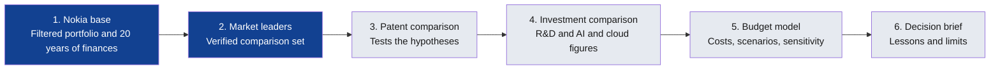

# Analysis strategy

How the project answers its central question, and what each output is for. The detailed hypotheses and pass rules are in the [research design](research-design.md), the evidence still needed is in [what I have and still need](evidence-gaps.md), and the reasons for each change in approach are in [how my approach changed](approach-changes.md).

This is an outside view. It uses public data and clearly labelled assumptions, not Nokia's internal figures.

## The central research question

> How does Nokia's patent portfolio and associated investment position compare with the leading competitors in AI and cloud infrastructure networking, and what strategic and financial lessons can be identified?

The financial side comes down to one problem: with a limited patent budget, how should it be allocated to get the most strategic and economic value?

## The role this project targets

The [Financial Data Engineering / Business Data Analytics Trainee posting](https://www.linkedin.com/jobs/view/4483030441) at Nokia, in the Business Data Analytics track.

| What the role does | Where it shows up here |
|---|---|
| Analyse patent portfolio and financial data | Nokia against rivals, with reported finances |
| Investment modelling | Cost forecast, and NPV for keep-or-drop decisions |
| Cost-efficiency studies | Cost per invention by office and technology |
| Scenario analysis | Three budget scenarios |
| Business cases | One recommendation with costs, benefits and risks |
| Demand and capacity planning | Forecast filings and renewals against team capacity |
| Presenting findings and reliability | One-page brief with ranges, assumptions and data limits |

The project also follows the posting's [expectations for how people work](principles.md).

## How the work fits together

Blue is built, and grey is still to do.

## The plan

| Step | Output | What it needs | Status |
|---|---|---|---|
| 1. Nokia base | [Workable portfolio](portfolio-filter.md) and [20 years of finances](twenty-years.md) | Google data and annual reports | Built, with lapsed and sold patents still to remove |
| 2. Market leaders | [Leader map and comparison set](competitors.md) | Company reports, IDC and Dell'Oro | Checked |
| 3. Patent comparison | Technology gap map | Tested technology definitions and a rival patent table | Next |
| 4. Investment comparison | R&D and AI and cloud comparison | Rivals' annual reports | Not started |
| 5. Budget model | Forecast, scenarios, sensitivity and a probability curve | Official fees and USPTO renewal records | Partly started |
| 6. Decision brief | Up to five findings, each with a decision | All of the above | Not started |

**Scope:** the US, Europe, China and Japan, in optical and IP networking. Filings use the last 30 years, and comparisons use 2020–2024 as the main period.

## What's been learned so far

- **Portfolio:** 72,207 families narrow to [19,873 granted within 20 years, plus 5,595 possibly pending](portfolio-filter.md), against [Nokia's reported 26,000+](twenty-years.md).
- **Data quality:** my new-family counts [follow Nokia's reported inventions](twenty-years.md#my-family-counts-follow-nokias-own-numbers), but grants outside the US are unreliable.
- **Market:** [no single company leads](competitors.md). Nokia's strongest public positions are in optical.
- **Licensing:** sales [swing with renewal cycles](twenty-years.md#licensing-income-moves-with-renewal-cycles), from €1,085M in 2023 to €1,928M in 2024.

## The financial analysis

### Keep-or-drop model

**Question:** how much value must a patent generate to justify its next renewal fee?

A worked example using the [USPTO large-entity fees](sources.md#patent-rules-and-data-sources), and the [median US time to grant of 4.05 years](../data/processed/patent_measures.csv):

| Renewal | Fee | Cover it buys | Break-even value per year at 5% | At 10% | At 15% |
|---|---:|---:|---:|---:|---:|
| 3.5 years | $2,150 | 4 years | $606 | $678 | $753 |
| 7.5 years | $4,040 | 4 years | $1,139 | $1,275 | $1,415 |
| 11.5 years | $8,280 | 4.45 years | $2,121 | $2,395 | $2,682 |

The three fees total $14,470, or about $6,284 in present value at 10%. The discount rate and the value of each patent are assumptions, because public data doesn't show them.

### Mean and median patent costs

Nokia's reports don't show patent costs, so these need official fees and renewal records. I can't get those records yet, as the [USPTO portal needs an account](data-map.md#whats-missing). This example shows how the calculation works, using assumed renewal rates and today's US large-entity fees:

| Share renewed at 3.5, 7.5 and 11.5 years (assumed) | Mean fees per patent | Median fees per patent |
|---|---:|---:|
| 90%, 80%, 70% | $9,017 | $14,470 |
| 80%, 60%, 40% | $5,249 | $2,150 |

The median can jump a long way with small changes, as fees come in large steps, so the mean and the full spread both matter. These are official renewal fees only, not filing or attorney costs. The rates are placeholders, not findings.

### Early answer: are fees big enough to matter?

A rough check for official US renewal fees: if 1,000–1,300 US patents a year were each kept for their full term, fees would reach about **$14.5M–$18.8M a year** once the portfolio is steady.

That's about **1% of Nokia's roughly €1.6B annualised licensing-unit sales**, before converting currency. It assumes every patent is renewed, so real fees could be lower.

**What this changes:** cutting renewals alone is unlikely to be the main prize, and a small saving wouldn't justify much licensing risk. The model also needs other offices, filing and attorney costs before it can say where the money goes. This is an order-of-magnitude check, not Nokia's real spend.

### Measured so far

| Measure | Mean | Median | Middle 80% | Patents or families |
|---|---:|---:|---:|---:|
| US years to grant | 4.27 | 4.05 | 2.16–6.66 | 10,855 |
| European years to grant | 6.17 | 5.79 | 2.79–9.92 | 6,417 |
| Chinese years to grant | 4.89 | 4.88 | 3.67–6.08 | 2,278 |
| Applications per core family | 3.68 | 3 | 1–6 | 19,873 |
| Offices per core family, including international filings | 3.43 | 3 | 1–6 | 19,873 |

Time to grant covers filings from November 2006 to 2015, so recent cases don't skew it short. Filings per family are low, because they rely on owner names and miss some records, such as many Japanese ones. Filing somewhere doesn't mean a patent is being maintained there.

### Budget scenarios

| Scenario | What changes | What I'd compare |
|---|---|---|
| **Keep everything** | Renew all eligible patents | Highest cost, least risk of dropping something valuable |
| **Narrow the geography** | Maintain fewer offices per invention | Savings against lost market cover |
| **Shift to AI and cloud** | Move spending from older areas to optical and IP | Savings against new filing costs, using the gap map |

I'll then test which assumptions move the answer most: renewal rates, fee growth, cost per application, exchange rates and the discount rate. The forecast will end in a range with a probability curve.

### Capacity plan

Volumes of filings and renewal decisions come from the forecast. Hours per task are assumptions, shown as ranges.

## Finance concepts in this project

| Concept | What it means here |
|---|---|
| **CAPEX vs OPEX** | Whether patent costs are recorded as a long-term asset or an expense. I don't know how Nokia treats each cost, so I'll model cash spending and flag this as a question |
| **Budget vs actuals** | Planned against actual spend. I can build the budget side, but actuals are internal |
| **Cost allocation** | Assigning costs to business units, offices and technologies. One family can serve several units, so the rule needs to be stated |
| **Cost drivers** | Number of inventions, offices per invention, patent age, fee levels and exchange rates |
| **ROI** | Return compared with cost. It needs a value for each patent, which has to be an assumption |
| **NPV** | Future value and costs converted to today's money. Used for keep-or-drop |
| **Discount rate** | How much less future money is worth today. I test a range because I don't know Nokia's rate |
| **Forecasting** | Estimating renewals and new filings by year |
| **Sensitivity analysis** | Changing one assumption at a time |
| **Scenario analysis** | Changing several assumptions together to compare futures |

## Known limits

- **Ownership and status:** the [filter](portfolio-filter.md) doesn't yet remove lapsed or sold patents.
- **Non-US grants:** these are undercounted, and [filings are found by family](twenty-years.md#japan-needed-fixing) to reduce the gap.
- **Recent years:** publication lags filing by about 18 months, so 2025–2026 are provisional.
- **Patent value:** citations and family size are indicators, not measures of commercial value.
- **Internal data:** Nokia's budget, cost per patent and licence terms aren't public. See [how far I trust each source](data-trust.md) and the [assumption register](assumptions.md).

## Rule for each new query

Before running a query, I write down:

1. **Which hypothesis or deliverable** it feeds
2. **The decision** it informs
3. **The measure** I'd use
4. **What result would change my mind**
5. **The main limit** of the data

If it doesn't feed one, the query doesn't get run.
