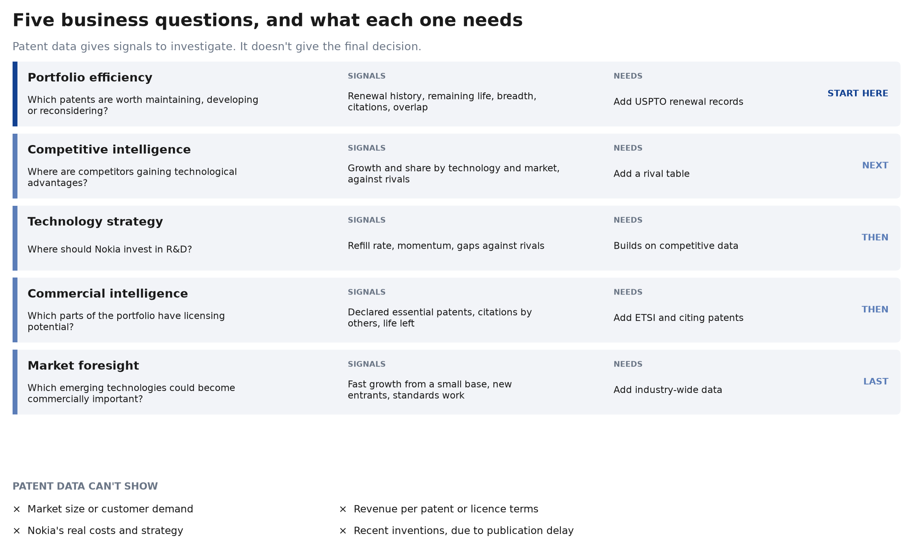
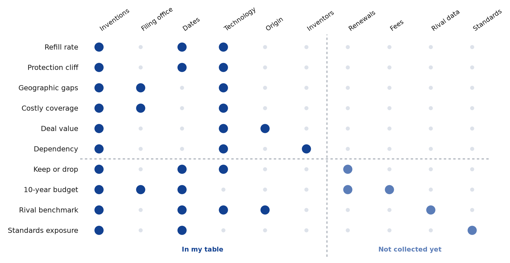

# Analysis strategy

I started by following whatever the data showed next. This page sets a method: start from a decision someone has to make, then work back to the data. [Here's why I changed approach](approach-changes.md).

This is my outside view of what a portfolio team needs. Nokia's real priorities may differ, and the results are signals rather than proof.

## The central question

> Across the last 30 years, where is the portfolio strong, where is it exposed, and where might it be costing more than it should?

## What each question needs

## What the data is made of

| Building block | Fields | Lets me compare by |
|---|---|---|
| **Inventions** | `family_id` | The basic unit of counting |
| **Filings** | `application_number`, `country_code` | How widely each invention is protected |
| **Time** | `priority_date`, `filing_date`, `grant_date` | Trends and expected expiry |
| **Technology** | `cpc_codes`, `title_en`, `abstract_en` | Which fields it covers |
| **Origin** | `owners` | Nokia, Alcatel, Lucent, Infinera and others |
| **People and places** | `inventors`, `inventor_countries` | Where the inventing happens |
| **Connections** | `cited_publications` | What each patent builds on |

## Answerable with my table now

| Business question | Decision it supports | Measure | Main limit |
|---|---|---|---|
| **Refill rate:** is new invention replacing what's about to expire? | Where to invest in new patents | New inventions against inventions reaching 20 years, by technology | Recent years are incomplete because of publication delays |
| **Protection cliff:** how much protection could run out by 2036? | What to renew or replace | Filing date + 20 years, by technology | An estimate: patents can lapse earlier, and term rules can move the date |
| **Geographic gaps:** which key technologies lack cover in major markets? | Where to file next | Share of inventions filed in each office, by technology | Filing is not the same as a granted patent |
| **Costly coverage:** which areas are filed in many more offices than others? | Where to file more narrowly | Offices per invention | Shows breadth, not actual money spent |
| **Deal value:** what did each acquisition add that Nokia didn't already have? | How to value future deals | Inventions by origin and technology, and how much they overlap | Names can be out of date |
| **Dependency:** which technologies rely on few countries or inventors? | R&D site and talent risk | Share held by the top countries and inventors | 18% of publications lack inventor country |

## Needs more data

| Business question | What's missing |
|---|---|
| Which patents are still alive? | USPTO fee records or PATSTAT legal events |
| Which patents should be dropped? | Renewal history and a measure of value |
| What will the portfolio cost over 10 years? | Official fees for each office, plus assumptions |
| How does Nokia compare with rivals? | The same table for Ericsson, Huawei and others |
| Which patents matter for 5G? | ETSI declarations |
| Which patents have the most influence? | Who cites them, from another search of the full table |

## Can't be answered from public data

- Revenue or return per patent
- Licensing terms and who holds a licence
- Nokia's actual internal costs and its reasons for each decision

## The plan

1. **Clean the base:** done for now, with [corrected US counts](../data/processed/us_30y_recount.csv) and [checked history](sources.md).
2. **Answer the six questions** above from my table.
3. **Add renewal data and fees** to reach Keep or drop and the 10-year budget.
4. **Write a decision brief:** one page on strengths, exposures and where to look for savings.

## Rule for each new question

Before running a query, I write down:

1. **The decision** it would inform
2. **The measure** I'd use
3. **What result would change my mind**
4. **The main limit** of the data

If I can't name the decision, it goes in a parking list instead of the plan. The same goes for anything that only confirms what's already obvious, like "Nokia moved to 5G".
